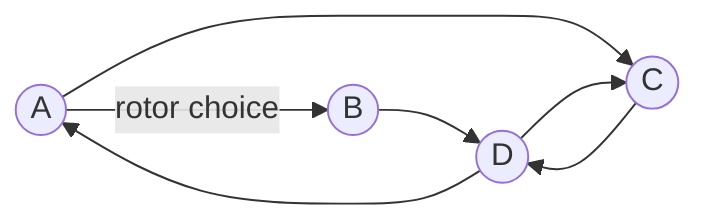
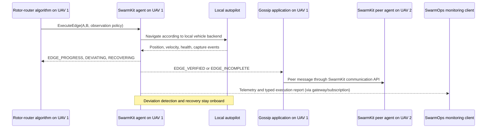
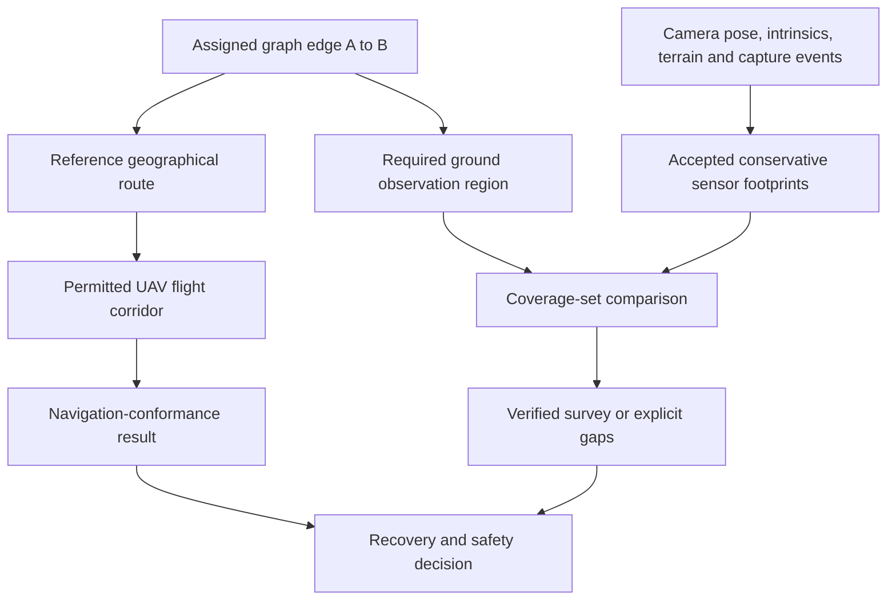
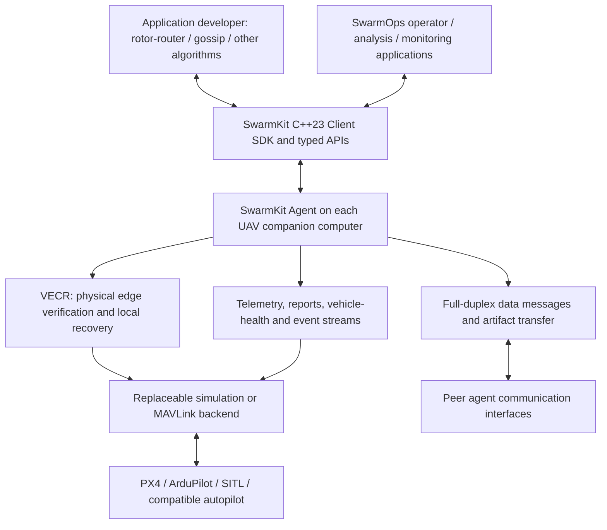
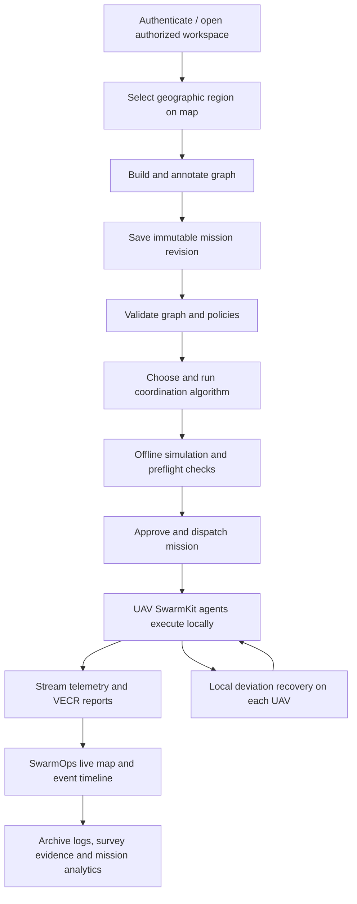
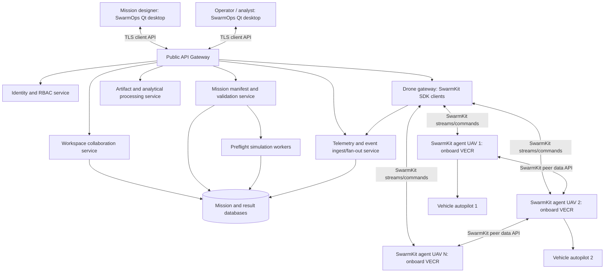

# A Multi-User Software System for Mission Engineering, Execution Verification, and Management of Self-Organizing UAV Swarms

**Dissertation-oriented research manuscript and technical reference**  
**Researcher:** Artyom Lazyan  
**Specialization:** E.13.04 — Mathematical and Software Support of Computing Machines, Complexes, Systems, and Networks  
**Research context:** Institute for Informatics and Automation Problems, National Academy of Sciences of the Republic of Armenia  
**Prepared:** October 2026  
**Status:** Extended research manuscript; **not a completed defended dissertation or a declaration that proposed VECR experiments have been performed**.

> **Proposed title (English):** *A Multi-User Software System for Mission Engineering, Execution Verification, and Management of Self-Organizing UAV Swarms.*  
> **Relationship to the originally approved Armenian title:** The original emphasizes multi-user formation and management of self-organizing UAV swarm missions. The proposed refinement adds *execution verification* while preserving the approved research domain. Any formal title change requires institutional approval.

## Navigation / Table of Contents

This self-contained Markdown file is intended for repeated consultation and supports clickable navigation in renderers such as GitHub. The manuscript separates **established research**, **inspected implementations**, **proposed theory**, and **required future evaluation**.

| Part | Sections |
|---|---|
| **Scientific foundation** | [1. Introduction](#chapter-01) · [2. Rotor-router, Eulerian and gossip theory](#chapter-02) · [3. Related work and research gap](#chapter-03) |
| **Proposed VECR method** | [4. Problem and system model](#chapter-04) · [5. VECR definition and algorithm](#chapter-05) · [6. Conditional mathematical proofs](#chapter-06) |
| **Software systems** | [7. SwarmKit SDK and onboard agent](#chapter-07) · [8. UAV peer/server communication](#chapter-08) · [9. SwarmOps platform](#chapter-09) · [10. SaaS architecture](#chapter-10) |
| **Validation and defense** | [11. Experimental methodology](#chapter-11) · [12. Worked case studies](#chapter-12) · [13. Scientific novelty](#chapter-13) · [14. Defense questions](#chapter-14) · [15. Limitations](#chapter-15) · [16. Conclusion](#chapter-16) |
| **Supporting material** | References, source provenance, notation, claim safeguards, figures and completion plan appear after Chapter 16. |

---

## Manuscript status, evidence rules, and scope

This document is an integrated **dissertation-style research draft**. It contains (i) foundations established in earlier peer-reviewed publications; (ii) research and engineering components inspected in the uploaded **SwarmKit** and **SwarmOps** snapshots; (iii) the **proposed** Verified Edge Coverage and Recovery (VECR) method, with definitions, candidate correctness statements, proof arguments, architecture and APIs; and (iv) an experimental program that **must be completed before the associated quantitative or physical-field claims can be asserted as demonstrated findings**. Mathematical propositions are original *proposed formulations* assembled for this manuscript; they are not represented as results already accepted by a journal or examined by a dissertation committee.

The following categories are deliberately kept separate throughout:

| Evidence category | Meaning | Representative basis |
|---|---|---|
| **Established mathematical background** | Published rotor-router, Eulerian and gossip results under their stated graph-theoretic assumptions | Poghosyan and Priezzhev; Papoyan et al.; Poghosyan et al. 2024 [R1–R4] |
| **Earlier platform publications** | Descriptions of mission preparation, simulation, platform evolution and SwarmKit | Lazyan and coauthors [R5–R10] |
| **Code present in uploaded ZIP** | Functions and interfaces inspected in the available snapshots, not necessarily production-validated | `swarmkit-main`, `swarm-ops-main` [S1–S2] |
| **Existing experimental evidence** | Results of the previous, separate SwarmKit state-acceptance experiment and SITL campaign | `results/dissertation/*` [S3] |
| **VECR research proposal** | New edge-obligation semantics, monitoring, coverage accounting, recovery, reporting, proof obligations and experiments | Chapters 5–10 of **this** manuscript |
| **Intended SaaS platform deployment** | A cloud-backed multi-user service architecture centered on the SwarmOps desktop client | Proposed integration; not the same as a verified public SaaS deployment |

**One decisive architectural rule:** Physical deviation detection, local recovery, arrival checks and verification of edge execution belong **inside the SwarmKit agent on the UAV companion computer**. Cloud services receive telemetry, mission progress and events; they do **not** perform the local deviation-correction loop. This is the design chosen for the present dissertation proposal, even where earlier publications describe alternative architectural arrangements.

### Abstract

Theoretical coordination algorithms for self-organizing unmanned aerial vehicle (UAV) swarms commonly represent motion as discrete transitions between vertices of a graph. The rotor-router model provides deterministic edge-selection mechanisms and, under established recurrence and graph assumptions, Eulerian coverage properties. Previous work by Vahagn Poghosyan and collaborators developed the relevant mathematical foundations; subsequent collaborative research addressed UAV swarm models, fault tolerance, gossip-based information exchange and software infrastructure. Nevertheless, an abstractly completed graph transition does not, by itself, establish that the associated geographical terrain was physically traversed or successfully observed by a real UAV. A vehicle may reach the destination while deviating around an intermediate survey strip, losing localization reliability, or failing to record necessary imagery. As a result, graph-level mission completion and physically verified sensing completion must be distinguished.

This manuscript proposes **Verified Edge Coverage and Recovery (VECR)**, an algorithm-independent, onboard method for supervising assigned graph edges, maintaining a conservative record of verified traversal and sensing, identifying incomplete geographical obligations, attempting bounded local recovery when admissible, and reporting authoritative execution outcomes to arbitrary high-level coordination algorithms. A graph edge is associated with a route, an admissible movement corridor, and an optional geographical observation region. Using sampled position estimates, time and speed/error bounds where defensible, and accepted sensor-footprint evidence, the method accumulates verified coverage intervals and identifies unverified gaps. A logical arrival at the destination is reported separately from the physical fulfillment of the edge-survey obligation. The method does not alter rotor-router update rules or replace autopilot stabilization and failsafes.

The proposed method is designed for **SwarmKit**, a C++23 UAV agent runtime and reusable SDK that exposes typed control, telemetry, execution-report and bidirectional communication interfaces above pluggable simulation and MAVLink-compatible vehicle backends. SwarmKit's communication APIs provide the substrate through which a developer may implement rotor-router, gossip, broadcast or alternative coordination and data-distribution protocols. A complementary **SwarmOps** multi-user, Qt/C++ mission-engineering application integrates map-based mission authoring, graph editing, simulation and visualization; an intended cloud service layer can support workspace sharing, mission storage, validation, analytics and telemetry dissemination while leaving physical correction onboard. The manuscript develops formal semantics, conditional correctness arguments, API contracts, safety limitations, related-work distinctions and a reproducible evaluation plan targeting false completion reports, residual survey gaps, recovery overhead and system scalability.

**Keywords:** UAV swarm; rotor-router; Eulerian graph traversal; Abelian networks; decentralized coordination; gossip dissemination; physical edge verification; geographical coverage; uncertainty-aware execution; recovery; distributed middleware; multi-user mission engineering; SwarmKit; SwarmOps; cloud-native platform.

---

<a id="chapter-01"></a>

# Chapter 1 — Introduction and Scientific Motivation

## 1.1 From mathematical swarm coordination to practical missions

A swarm of UAVs consists of multiple airborne agents that execute coordinated tasks such as area mapping, environmental observation, inspection, search and distributed sensing. A central scientific challenge is to organize their movements and information exchange so that the global mission remains coherent while individual vehicles act locally. Graph-based models provide an attractive abstraction: vertices represent admissible positions or operational regions, directed edges represent permitted transitions, and local algorithmic state determines the next transition.

The abstraction is powerful because it makes coordination mathematically analyzable. Instead of reasoning directly about propellers, wind, camera orientation and network packets, the mathematical model can reason about rotor states, directed edges, concurrent agents and coverage of a finite graph. Its theoretical results can hold regardless of which agent performs a particular discrete step first, subject to the hypotheses of the theorem.

A real UAV is not a mathematical chip. Moving from A to B is an extended physical event that consumes time and energy. Navigation is based on imperfect estimates; the UAV may temporarily leave the assigned geographical route, experience an autopilot mode change, stop recording, encounter wind, or lose a communications link. Some of these events are compatible with the high-level graph walk. Others may leave portions of an observation task incomplete despite the UAV eventually reaching its destination.

The dissertation therefore examines an **abstraction refinement problem**: how can a program implementing discrete graph-based swarm coordination receive a faithful account of the physical work accomplished by a vehicle? The goal is not to replace the graph-theoretic coordination method, but to supply a reusable execution layer with explicit semantics that higher-level coordination methods can trust **under stated physical and measurement assumptions**.

## 1.2 The physical fulfillment gap

Let `GraphVisit(e)` mean that the coordination algorithm executed its abstract transition corresponding to directed graph edge `e`. Let `Arrived(B)` mean that the physical UAV reached its destination vertex. Let `Surveyed(R_e)` mean that the terrain region associated with that edge was sufficiently observed according to the mission specification.

These are distinct propositions:

\[
\operatorname{GraphVisit}(e)\not\Rightarrow \operatorname{Surveyed}(\mathcal R_e),
\qquad
\operatorname{Arrived}(B)\not\Rightarrow \operatorname{Surveyed}(\mathcal R_e).
\]

The non-implications arise even when the rotor-router theorem is perfectly correct. For example, the drone can start at A, depart from the route because of a disturbance, later rejoin near B and satisfy B's waypoint-arrival radius. The graph step may be considered finished, yet the camera never observed an intermediate strip. A second example is a camera malfunction during an otherwise geometrically correct route. A third is a burst of stale GNSS measurements: the system cannot soundly certify a geographical path during the period of unknown motion merely because the last reported position was close to the expected line.

The corresponding scientific question is:

> **How can a decentralized UAV execution layer verify the physical fulfillment of graph-edge traversal and sensing obligations, preserve confirmed partial progress under disturbances, and expose incomplete obligations to arbitrary coordination algorithms without changing their mathematical transition rules?**

This question is narrower—and more defensible—than claiming to have invented fault tolerance for rotor-router, basic waypoint arrival, camera footprint geometry, navigation corridors, or general drone middleware.

## 1.3 Research goal

The **principal research goal** is to develop and evaluate a formally specified, algorithm-independent method for **Verified Edge Coverage and Recovery (VECR)**, realized locally in the SwarmKit agent. The method must:

1. represent each graph edge as a physical execution obligation with well-defined navigation and optional sensing requirements;
2. monitor movement between source and destination, including disturbances and uncertainty;
3. accumulate only sufficiently supported evidence of physical edge fulfillment;
4. keep unverified geographical regions distinguishable from verified ones;
5. attempt bounded local recovery or report an incomplete task when local recovery cannot be performed;
6. distinguish physical arrival, verified survey fulfillment, interruption and unknown outcome;
7. expose those outcomes to rotor-router, gossip, broadcast or alternative applications through stable SwarmKit control, reporting and communication APIs;
8. integrate with a multi-user mission platform that prepares graph missions, runs repeatable simulations and displays observed physical progress.

The objective explicitly excludes redesigning rotor-router theory, implementing an unspecified new cryptographic protocol, asserting a universal collision-avoidance guarantee, or promising that physical recovery always succeeds.

## 1.4 Research questions and hypotheses

**RQ1 — Semantic correspondence.** Can a graph-edge completion predicate be defined such that a successful physical-fulfillment report implies satisfaction of a clearly stated surveying obligation, under defensible sensing and motion assumptions?

**RQ2 — Recovery and progress.** Can the verification engine preserve valid partial progress, identify gaps and thereby reduce the need to repeat previously verified surveying when a vehicle deviates or the task is interrupted?

**RQ3 — Algorithm independence.** Can rotor-router and at least one non-rotor-router graph planner use the same onboard execution contract, without embedding the planners' internal mathematics in SwarmKit?

**RQ4 — Distributed observability.** Can peer agents and external SwarmOps clients receive usable progress and failure reports through typed, full-duplex communication APIs while local correction remains independent of cloud connectivity?

**RQ5 — Practical performance.** What trade-offs arise among localization uncertainty, telemetry rate, footprint-conservatism, missed-region detection, repeated coverage, message load and Raspberry Pi CPU use?

Testable hypotheses are: (H1) VECR produces fewer **false physical-survey completion reports** than destination-only acknowledgement; (H2) preserving verified intervals reduces repeated surveying compared with unconditional edge restart when gaps are localized; and (H3) the same execution semantics support distinct high-level graph algorithms and transport/application-layer dissemination policies. These are research hypotheses, **not measured conclusions**.

## 1.5 Contributions and originality boundary

The proposed scientific contribution is one coherent **physical edge-fulfillment method** with a formal completion predicate, bounded-motion monitoring, evidence-based progress representation, recovery behavior and a stable algorithm-independent reporting contract. Supporting systems contributions are its SwarmKit implementation and integration with a multi-user SwarmOps/cloud workflow.

The mathematical rotor-router properties are credited to their original authors. Gossip optimization and fault-tolerant swarm coordination previously developed by the research group are background, not newly rebranded as VECR. Standard gRPC, MAVLink, PX4, ArduPilot, GNSS waypoint acceptance, and ordinary peer-to-peer networking are engineering foundations rather than newly invented technologies. The actual novelty claim must survive a literature comparison of **edge-level geographical fulfillment accounting and interruption recovery**, including related work in coverage path planning and robotics middleware.

---

<a id="chapter-02"></a>

# Chapter 2 — Theoretical Foundations: Rotor-Router, Eulerian Traversal and Gossip

## 2.1 Graph representation of the operational area

The mission is modeled as a directed graph

\[
G=(V,E),\qquad V=\{v_1,\ldots,v_n\},\qquad E\subseteq V\times V.
\]

A vertex may represent a geographical waypoint, survey cell, task location or topological junction. A directed edge `e=(u,v)` represents an admissible movement obligation from `u` to `v`, possibly with an associated physical survey region. The reverse edge `(v,u)`, when present, is a **different directed edge** and may imply a different observation heading or sensor coverage expectation.

An Eulerian directed graph has balanced in-degree and out-degree at each vertex, together with connectivity conditions sufficient to admit an Eulerian tour. An **Eulerian circuit** traverses every directed edge exactly once in the **abstract walk** before returning to the starting vertex. Physical recovery flights do not necessarily satisfy a 'traversed exactly once' constraint and should not be confused with this theorem.

## 2.2 Rotor-router local dynamics

A rotor is associated with each vertex `v`. Let its outgoing directed edges have a fixed cyclic order and let `d_v` be the out-degree of `v`. Its rotor index is

\[
\alpha_v\in\{0,\ldots,d_v-1\}.
\]

In the increment-before-move convention described in the group's 2024 mathematical model, a chip arriving at `v` updates the rotor and chooses its next edge:

\[
\alpha_v\leftarrow(\alpha_v+1)\bmod d_v,
\qquad
v\longrightarrow\operatorname{succ}(v,\alpha_v).
\]

The state comprises the rotor configuration \(\rho=(\alpha_v)_{v\in V}\) and the chip position. The walk is deterministic once the graph, rotor order and initial state are fixed. This determinism is useful for reproducible simulation and for the interpretation of expected logical progress.



*Figure 2.1 — Example of a directed mission graph. Rotor state selects the next outgoing edge; the arrows represent abstract transitions, not fully specified flight-control trajectories.*

## 2.3 Recurrent states, unicycles and Eulerian tours

Published rotor-router theory analyzes recurrent states using **unicycles**: spanning directed structures with a unique directed cycle and the chip situated on that cycle. In the Eulerian setting, iterated rotor-router moves from the appropriate unicycle state can realize an Eulerian tour. In the 2024 paper, Theorem 2 (attributed to Holroyd and collaborators) states the result for `m=|E|` steps on a finite Eulerian graph, under its hypotheses [R3].

This statement gives a precise guarantee about the sequence of **graph edges**. It does not state that a real aircraft will always fly safely, that its camera will work, that GNSS error is bounded, or that an imagery product has no geographical holes. Those conclusions require additional physical and sensing models.

## 2.4 Loop reversibility and the Abelian aspect

Vahagn Poghosyan and collaborators investigated Euler tours, unicycles, loop reversal and related rotor-router properties [R1–R2]. The multi-agent models discussed in the group's publications exploit Abelian properties or order-independence results under specified legal transition rules and termination conditions. Their implications are substantial: a swarm may distribute a larger graph-level task across multiple asynchronously progressing agents without demanding equal flight speeds at every instant.

However, **Abelian order-independence does not remove physical sensing requirements**. The schedule of abstract vertex transitions may be immaterial to a particular theorem while the geographical region observed by a UAV's camera still depends on its actual path, pointing geometry, timing and sensor condition.

The distinction is fundamental:

\[
\text{order-independent logical result}
\quad\not\Rightarrow\quad
\text{automatically verified physical sensing result}.
\]

## 2.5 Multi-agent motion and crash-related reassignment

The group's 2024 UAV mathematical-model paper describes distributing Eulerian traversal across multiple agents, including cases in which motion speeds differ. It describes exchanges of whether a drone managed to reach its target vertex and reassignment of work following a UAV crash [R3, pp. 3–6]. Accordingly, the present dissertation does **not** suggest that rotor-router is incapable of handling slow agents or that VECR invents failure redistribution.

What the paper does not formalize as a **per-edge sensor-level acceptance test** is how the physical execution layer produces the truth value of 'this required survey has been completed' from uncertain continuous-motion and camera evidence. VECR supplies such a contract. Importantly, even after VECR reports an incomplete task, rotor-router or another high-level coordinator must decide **whether and how** to redistribute it. VECR must not rewrite mathematical rotor states without authorization.

## 2.6 Gossip and fault-tolerant information dissemination

**Rotor-router answers:** Which graph transition should be selected next?  
**Gossip/broadcast answers:** How do distributed agents exchange known state, observations and task information?  
**VECR answers:** What physical task was actually verified during execution of the selected transition?  
**SwarmKit communication APIs answer:** Through what reusable software and transport interfaces can applications exchange those results?

The earlier swarm papers discuss fault-tolerant gossip/broadcast constructions and information exchange using graph structures, including Knödel-related research and security considerations [R3–R4]. A gossip protocol is a higher-level dissemination strategy: nodes exchange data with selected peers according to the protocol's state and rules. Depending on topology and connectivity assumptions, repeated information exchange can spread observations across the swarm and support recovery after some faults.

In the proposed architecture SwarmKit does **not** hard-code gossip as the mandatory coordination algorithm. Instead, its client/agent and bidirectional data APIs give a gossip implementation access to typed messages and peer communication, and can equally serve a flood, tree broadcast, consensus-like application, or other policy. Actual full dissemination or message-delivery guarantees remain the responsibility of the selected protocol and network assumptions.

### Example distributed interaction



*Figure 2.2 — Distinct logical, physical and communication responsibilities. The peer algorithm may distribute results, but the physical truth assessment is local to the drone.*

## 2.7 Why theoretical fault tolerance does not eliminate VECR

Consider a drone crash. The mathematical coordination method can specify that another drone takes responsibility for pending graph-level work. Yet it is not necessarily known **how much of a physical survey strip the crashed vehicle had already observed**. If no valid record survived the crash, safety-conscious execution repeats the unknown portion. If partial evidence was already replicated through a peer-to-peer channel, already verified work can be retained and only the missing portion reassigned.

This difference has practical consequences. VECR does not replace the group's fault-tolerant algorithm; rather, it offers accurate **physical work accounting** that can be exchanged and exploited by whichever fault-tolerant algorithm is used.

## 2.8 Explicit boundaries of the mathematical results

The following should be stated in a defense presentation:

- The **graph-theoretic Eulerian guarantee** concerns specified abstract edge traversals, not sensor success or real-world wind immunity.
- The **multi-agent/asynchronous guarantee** is not automatically a guarantee of collision-free flight or guaranteed recovery from arbitrary faults.
- The **communication theorem** can establish message dissemination under network assumptions; it does not show that the data being disseminated describes physically completed surveying unless a physical-execution verifier supplies that meaning.
- The **VECR method** therefore addresses a distinct refinement layer: observable physical fulfillment and pending obligations.

---
<a id="chapter-03"></a>

# Chapter 3 — Related Work, Research Gap and Design Requirements

## 3.1 Waypoint navigation is not itself a novel contribution

Autopilot ecosystems already provide waypoint acceptance radii, mission execution, trajectory controllers, return-to-launch/landing procedures and navigation-failure handling. For example, PX4 defines mission waypoint acceptance/turning radii [R11]; ArduPilot's mission-command documentation likewise describes waypoint completion [R12]. These functions should be reused, not rediscovered under a different name.

Similarly, the ROS 2 Navigation2 ecosystem includes goal checking, route graphs, feedback, controller recovery and replanning [R13]. An architecture containing `MOVING`, `RECOVERING` and `REACHED` states is ordinary robotics engineering unless the state meanings satisfy a new, useful and established correctness property. Geographic corridors, robust trajectory tubes, coverage-path planning and camera footprint analysis are also existing research domains [R14–R16].

The specific contribution investigated here is **runtime, mission-semantic verification of an assigned graph edge's physical obligation**, along with conservative coverage accounting and recovery that preserve the distinction between *nominal graph traversal*, *physical movement*, *sensor observation* and *verified surveying*. The distinction must be supported by prior-art comparisons and experiments; a new acronym alone does not establish priority.

## 3.2 A taxonomy of existing and proposed completion signals

| Signal or mechanism | What it actually proves or reports | What it does **not** prove by itself |
|---|---|---|
| Command transport ACK | Command delivered to a backend or acknowledged as accepted | Drone physically reached the target |
| Autopilot waypoint arrival | Controller-specific position/finish criterion satisfied | Whole A→B corridor surveyed |
| Cross-track corridor alarm | At a sample, estimated position is outside permitted route tube | An actual sensing gap necessarily exists |
| GNSS track near intended route | Recorded locations are close to route | Camera was operational and images usable |
| Capture count or shutter pulse | Some captures were commanded or reported | Specified terrain fully observed |
| Camera-footprint union | Under assumptions, modeled footprints cover specified region | Every image is interpretable under all environmental conditions |
| **VECR edge fulfillment** | The declared physical traversal/survey obligation is supported by accepted evidence under explicit assumptions | Universal truth without valid measurement/sensor assumptions, or guaranteed mission recovery |

These distinctions prevent the dissertation from conflating control-system confirmation with mission completion.

## 3.3 The missing semantic layer

A common software architecture is `planner → goto → autopilot → arrived`. Such a flow is adequate for many point-to-point tasks. It becomes insufficient for a mission in which each edge represents **work along the route** rather than just a destination. A robust system needs a different contract:

`planner → edge obligation → monitored execution + evidence → [verified / incomplete / unknown]`.

This contract can be provided as reusable middleware. It does not need to know why the planner selected the edge, whether the planner is rotor-router, nor which dissemination protocol carries the result to peer drones.

## 3.4 Necessary system requirements

The proposed method and supporting software must satisfy the following requirements.

| ID | Requirement | Scientific or engineering motivation |
|---|---|---|
| RQ-01 | Distinguish `ARRIVED` from `SURVEY_VERIFIED` | Avoid false implication between waypoint arrival and observation fulfillment |
| RQ-02 | Represent directed edges and mission revision identifiers | Preserve task identity and graph semantics |
| RQ-03 | Accept uncertain sampled movement only under declared conditions | Avoid silent claims about intervals not observed |
| RQ-04 | Maintain verified **sets or intervals**, not just a scalar completion percentage | Preserve discontinuous observations and explicit gaps |
| RQ-05 | Identify a conservative safe re-entry zone for recovery | Resume incomplete work without blindly repeating everything |
| RQ-06 | Keep physical supervision local to the companion computer | Continue operation despite loss of ground/cloud connectivity |
| RQ-07 | Respect existing autopilot failsafes and backend capabilities | Avoid commanding contradictory or unsafe vehicle actions |
| RQ-08 | Expose typed telemetry, progress, fault and edge-result events | Enable arbitrary local planners, peer algorithms and SwarmOps monitoring |
| RQ-09 | Offer bidirectional APIs for drone–drone and drone–server messaging | Separate communication substrate from gossip/broadcast policies |
| RQ-10 | Retain evidence/obligation identity over temporary disconnects | Enable reconciliation without assuming message delivery |
| RQ-11 | Support simulation, SITL and representative real hardware | Establish reproducibility and practical relevance |
| RQ-12 | Provide consistent authoring, mission identity and visualization | Link local execution to the multi-user workflow |

## 3.5 Why the specialization E.13.04 is an appropriate home

The thesis is not limited to an autopilot control loop. It concerns mathematical interpretation of discrete algorithms on physical devices, validity of software decisions, distributed message semantics, middleware abstraction, state machines, communication interfaces, concurrent services, reusable APIs, simulation experiments and cloud-backed collaborative software. These are natural topics within **Mathematical and Software Support of Computing Machines, Complexes, Systems, and Networks**, provided the proposed scientific result is actually formalized and validated.

---

<a id="chapter-04"></a>

# Chapter 4 — Scientific Problem Statement and System Model

## 4.1 Abstract mission model

Let the assigned mission be

\[
\mathcal M=(G,\Gamma,\mathcal R,\mathcal P,U,\nu),
\]

where:

- \(G=(V,E)\) is a finite directed mission graph;
- \(\Gamma=\{\gamma_e\}_{e\in E}\) assigns each directed edge a physical reference curve;
- \(\mathcal R=\{\mathcal R_e\}_{e\in E}\) assigns an optional required terrain-observation region;
- \(\mathcal P\) contains accepted motion, sensing, safety and recovery policies;
- \(U\) is the set of participating UAV agents;
- \(\nu\) is an immutable mission revision identifier.

For a straight edge, \(\gamma_e(s)=A+(B-A)s/L_e\), \(s\in[0,L_e]\), with \(L_e=\|B-A\|\). A polyline or differentiable curve generalizes the route for complex terrain. A graph edge is **directed**. The same geographic line traversed in opposite directions can be a distinct logical obligation and can imply different sensor view requirements.

## 4.2 Physical state and sensor state

A UAV physical state at time \(t\) may be represented abstractly as

\[
x_i(t)=\big(p_i(t),v_i(t),a_i(t),q_i(t),b_i(t),m_i(t)\big),
\]

where \(p_i\), \(v_i\), \(a_i\) denote position, velocity and acceleration; \(q_i\) is navigation-quality status; \(b_i\) is battery/health state; and \(m_i\) denotes flight and payload modes. The method does not assume that all components are always observable or reliable.

Telemetry is sampled at irregular event times \(t_k\). A received estimate \(\hat p_k\) is not automatically equal to the physical position. If a **justified hard error bound** \(\varepsilon_k\) is available, the true position satisfies

\[
\|p(t_k)-\hat p_k\|\le\varepsilon_k.
\]

An estimated variance or GNSS-reported 'accuracy' is **not automatically a hard bound**; using it as one without an appropriate confidence model invalidates a deterministic proof. The method must either establish a contractual bound, offer a separately labeled probabilistic verification mode, or declare that interval unverified.

The payload-sensor state includes capture time, device and calibration identity, pose/attitude estimate, camera parameters, quality indicators, storage/acknowledgement status and any available evidence of successful acquisition. These observations can be used to conservatively estimate sensor ground footprints.

## 4.3 The edge's geographical obligation

For each edge \(e\), let \(\mathcal R_e\subset\mathbb R^2\) denote the **required observation region**. This need not be identical to the flight corridor. A UAV may fly slightly off center and still observe the required ground strip. Conversely, a UAV can remain inside the flight corridor with a nonfunctioning camera and observe nothing useful.

Thus there are two distinct geometrical objects:

\[
\mathcal C_e=\{x:\operatorname{dist}(x,\gamma_e)\le w_e(x)\}
\quad\text{(admissible flight corridor)},
\]

\[
\mathcal R_e\quad\text{(required ground observation region)}.
\]

The corridor can be a tube with constant width or a piecewise prescribed corridor depending on airspace restrictions and mission policy. A camera footprint is an area on the ground whose shape depends on altitude, optics, vehicle attitude, terrain and image geometry. They are conceptually separate.

### Diagram: why three regions must not be conflated



*Figure 4.1 — Navigation geometry, observation geometry and completion are separate mechanisms.*

## 4.4 Three independent notions of success

For assigned edge \(e=(A,B)\), define:

- `NAV_ARRIVED(e)`: arrival conditions at the physical destination B are established by the selected arrival policy;
- `TRAVERSAL_VERIFIED(e)`: the specified geographical movement requirement is established by accepted movement evidence;
- `SURVEY_VERIFIED(e)`: the required observation region is covered by accepted sensor evidence according to the mission policy.

A mission may require only navigation arrival, navigation plus route traversal, or all three. For an edge-based imaging mission the strongest completion policy may be

\[
\operatorname{EDGE\_FULFILLED}(e)=
\operatorname{NAV\_ARRIVED}(e)\land
\operatorname{TRAVERSAL\_VERIFIED}(e)\land
\operatorname{SURVEY\_VERIFIED}(e),
\]

but the policy is configurable. For some missions, sensor evidence alone may establish the required geographical observation even after an off-route flight; an off-route event then remains a **navigation/safety issue** rather than proof of missed terrain.

## 4.5 Counterexample: arrival without surveying

Let A=(0,0) and B=(100,0). The required survey strip is a rectangle containing the centerline. Suppose the UAV flies A→(40,0), then detours to (60,30) and eventually reaches B while no camera footprint covers the terrain between x=40 and x=70. Under a position-only arrival rule, the mission succeeds because \(p(t_f)\approx B\). Under physical surveying semantics, there is an unverified portion of the required region.

**Consequences:** If the high-level rotor-router walk marks the edge as visited purely from the destination state, the graph-theoretic transition count may be correct while the actual surveying task remains incomplete. The correct software response is to report **both facts**, not force the graph algorithm to treat them as identical.

## 4.6 Counterexample: correct corridor, invalid observation

Suppose the UAV traverses the reference path precisely but the camera stops capturing at halfway. Its physical route is conformant. Nevertheless, \(\mathcal R_e\) is not fully supported by accepted observation evidence. Thus checking only cross-track error is insufficient for the sensing claim.

## 4.7 Counterexample: off-corridor movement with valid observation

A wide-angle camera at a compatible altitude may observe the entire required strip even while the UAV's location is temporarily outside the nominal corridor. Declaring all captured data invalid because of a deviation would waste information and could cause unnecessary repeat flights. VECR therefore evaluates **navigation conformance** and **sensor coverage** as different predicates. An off-route condition can trigger safety-aware recovery without automatically erasing accepted sensor evidence.

## 4.8 Fault, uncertainty and failure semantics

`UNKNOWN` is a legitimate and essential outcome. Missing packets are not proof of vehicle destruction. Low battery is a health condition that can terminate an ordinary surveying attempt; it is not sufficient by itself to infer that all earlier observations were invalid. GPS failure prevents new strong geographical statements based on that sensor, but should not silently erase earlier valid observations. An agent restart must not convert a previously incomplete edge into a completed one.

This distinction separates **physical capability and observation validity**, **communication reachability**, **mission obligation state**, and **planner-specific fault reassignment**. The VECR method focuses on the first three; the planner decides the fourth.

---

<a id="chapter-05"></a>

# Chapter 5 — Proposed VECR Method: Verified Edge Coverage and Recovery

## 5.1 Definition and contribution

**VECR** is an **algorithm-independent onboard execution and verification method** for graph-edge obligations. Given \(e=(A,B)\), a physical route \(\gamma_e\), an allowed corridor \(\mathcal C_e\), a required observation region \(\mathcal R_e\), and an execution policy, VECR supervises the moving UAV, evaluates accepted navigation and sensor evidence, maintains verified and outstanding geographical coverage, attempts bounded local correction when allowed, and reports explicit status to higher-level algorithms.

Its defining feature is **verified physical fulfillment**, not merely deviation detection. In an edge-based surveillance mission, the core invariant is that **a graph-edge surveying obligation is not reported fulfilled while its required geographical observation remains unsupported under the declared policy**.

## 5.2 Design principles

1. **Separate concerns:** Planning algorithms select graph transitions; VECR evaluates their physical fulfillment; low-level autopilots stabilize and navigate; transport APIs carry messages; gossip policy decides dissemination.
2. **No false certainty:** Unknown or poor-quality evidence does not produce a strong completion claim.
3. **Retain useful partial work:** Verified coverage intervals survive recoverable interruptions, subject to identity, persistence and evidence validity.
4. **Avoid needless control competition:** Ordinary wind tracking is an autopilot function; VECR intervenes only when mission-level conformance is materially violated.
5. **Protect safety precedence:** Battery, estimator and autopilot critical failsafes outrank mission recovery.
6. **Keep the original graph walk independent:** VECR does not choose the rotor order or modify algorithm-owned logical rotor state.
7. **Local autonomy:** No cloud connection is required for the agent's own transition monitoring and recovery decisions.
8. **Typed reporting:** Both the local planner and remote/peer subscribers can distinguish arrival, verified edge fulfillment, incomplete observation, failure and unknown outcome.

## 5.3 Physical edge request

A proposed edge-execution request contains

\[
T_e=(id,i,e,\gamma_e,\mathcal C_e,\mathcal R_e,\pi_e,\nu),
\]

where `id` is a unique transition request identity, `i` the UAV identity, `e` the directed graph edge, \(\pi_e\) the selected policy, and \(\nu\) the mission revision. The unique ID is used to reject stale duplicates and to allow coherent reconciliation after reconnect; this is standard distributed-system practice, not an independent claimed invention.

### Example conceptual request

```yaml
transition_id: "mission-v7/uav-03/edge-42/attempt-2"
mission_revision: 7
drone_id: "uav-03"
edge_id: "A->B"
source: {x_m: 0, y_m: 0}
target: {x_m: 100, y_m: 0}
physical_route: {type: polyline, points: [[0, 0], [100, 0]]}
flight_corridor: {half_width_m: 4.0}
observation_policy:
  mode: terrain_survey
  required_strip_half_width_m: 8.0
  minimum_coverage_fraction: 0.999
arrival_policy: {type: stop_and_confirm, radius_m: 2.0, max_speed_mps: 0.5}
recovery_policy: {enabled: true, max_attempts: 2, require_autopilot_approval: true}
```

*Illustrative proposed schema; these fields are not represented as an already existing SwarmKit `.proto` message.*

## 5.4 Corridor-conformance monitoring

For point \(p\) and route \(\gamma_e\), let

\[
d_e(p)=\inf_{s\in[0,L_e]}\|p-\gamma_e(s)\|.
\]

In the simplest case a corridor has constant half-width \(w_e\). A sample is nominally conformant when \(d_e(\hat p_k)\le w_e\); however, this does not establish that the entire **unobserved time interval** between telemetry samples remained conformant.

A stronger, still compact, reasoning technique uses motion bounds. Suppose \(\|\dot p(t)\|\le V_{\max}\) over an interval and endpoint true-to-route distances are bounded by

\[
D_k=d_e(\hat p_k)+\varepsilon_k,\quad D_{k+1}=d_e(\hat p_{k+1})+\varepsilon_{k+1}.
\]

Because the distance to a fixed closed route is 1-Lipschitz, for any \(t\in[t_k,t_{k+1}]\),

\[
d_e(p(t))\le \min\{D_k+V_{\max}(t-t_k),\;D_{k+1}+V_{\max}(t_{k+1}-t)\}.
\]

Since the minimum of two quantities does not exceed their arithmetic mean, the right-hand side is no greater than the **time-independent sufficient upper bound**

\[
\boxed{
U_k=\frac{D_k+D_{k+1}+V_{\max}(t_{k+1}-t_k)}{2}.
}
\]

Therefore \(U_k\le w_e\) is a **sufficient**, not necessary, condition ensuring corridor membership throughout the interval **provided the bounds are valid**. It may conservatively reject perfectly acceptable motion during sparse sampling; that trade-off is part of the proposed experimental study.

This inequality is not claimed as novel mathematics. Its contribution is the proposed integration with **edge progress accounting**, enabling the method to avoid treating unchecked time gaps as verified traversal.

## 5.5 Directional route progress

For a straight directed edge with A and B represented in a local metric coordinate frame, define longitudinal progress by

\[
s(p)=\operatorname{clip}_{[0,L_e]}
\left(
\frac{(p-A)\cdot(B-A)}{\|B-A\|}
\right).
\]

The direction matters: progression from B to A is not automatically fulfillment of directed edge A→B. Moreover, for curved edges, nearest-route projection can be ambiguous near loops or self-approaching sections; the implementation must use path-segment association, direction and temporal consistency rather than a naive global nearest-point result.

The observed maximum of \(s(p)\) is **not a verified coverage frontier**. A drone may bypass a middle section while reaching a large longitudinal coordinate. Instead, accepted intervals along the route are stored, merged when they overlap, and used to identify gaps.

## 5.6 Conservative movement verification

Let \(I_k=[s^-_k,s^+_k]\) denote a longitudinal interval **proved** traversed under a defined movement-conformance predicate. A movement interval is accepted only if both the geometric bound and its evidence-quality requirements are satisfied. In two-dimensional movement, continuity and endpoint projection arguments can establish that intermediate longitudinal positions were crossed if the relevant motion and projection assumptions hold. This is not a substitute for the independent sensing predicate.

The physically verified traversal set is

\[
\mathcal T_e=\bigcup_{k\in K_{\mathrm{accepted}}}I_k.
\]

An optional continuous verified prefix is

\[
c_e=\sup\{s\in[0,L_e]:[0,s]\subseteq\mathcal T_e\}.
\]

In a real implementation, \(\mathcal T_e\) is represented using merged intervals or small grid bins, and numerical tolerances are explicit. Intervals that become disjoint because of missing measurements do not magically join because later positions are close to B.

## 5.7 Sensor-footprint verification

Physical surveying requires observation evidence, not only motion evidence. For accepted capture `j`, let \(F_j\) be its actual ground footprint and \(F^-_j\) a **conservative estimated footprint** constructed so that

\[
F^-_j\subseteq F_j
\]

under declared calibration, pose, terrain and sensor-quality assumptions. A practical approximation may shrink the nominal footprint by localization and attitude uncertainty margins. A capture that is missing, corrupt, incompatible with the mission's modality, or not trustworthy under the chosen policy does not contribute a strong verified footprint.

Define the verified geographical observation set for edge `e`:

\[
\boxed{
\mathcal V_e=\mathcal R_e\cap\bigcup_{j\in J_{e,\mathrm{valid}}}F^-_j.
}
\]

The unverified region is

\[
\boxed{
\mathcal U_e=\mathcal R_e\setminus\mathcal V_e.
}
\]

`VECR` supports a **navigation-only mode**, where success concerns arrival/traversal and not imagery, and a **survey mode**, where the above footprint criterion is evaluated. These separate modes make the SDK useful for non-camera vehicles and non-survey graph tasks.

### Picture: two different types of progress

```text
  Directed edge A ---------------------------------------------- B
                0 m              50 m                       100 m

  Physical track:     ==============================-------------
  Track verified:     [=============================] [unknown]

  Camera evidence:    [==============]       [==================]
                                    ^ gap in observed terrain

  VERIFICATION RESULT:
    Arrival at B:                  may be true
    Entire traversal verified:     depends on movement evidence
    Entire terrain surveyed:      false until camera gap is filled
```

*Figure 5.1 — A physical-track record, camera-footprint union and destination arrival are not interchangeable.*

## 5.8 Coverage-completion predicate

The strongest zero-gap form is

\[
\boxed{
\operatorname{SurveyVerified}(e)\iff\mathcal U_e=\varnothing.
}
\]

A practical policy may allow a small, explicitly specified residual measure:

\[
\mu(\mathcal U_e)\le\delta_e,
\]

where \(\mu\) denotes the relevant area or route-length measure. A numerical tolerance is not a hidden claim of total coverage; the output should record the tolerance and residual. If the mission requires every point, \(\delta_e=0\) in the mathematical specification, with an appropriate discrete raster approximation in software.

## 5.9 Recovery from incomplete coverage

Recovery is **not** equivalent to 'go to the nearest point on the route'. Suppose the first 40 m of a 100 m edge are verified and the next 20 m are missing. The system should find a feasible re-entry region that preserves necessary overlap before the missing section and that can be reached without violating safety policy. A return to the **last verified place** is a valuable intuitive rule, but the actual waypoint can be before the frontier or at another admissible position based on vehicle dynamics and local obstacles.

A candidate re-entry longitudinal position may be selected as

\[
s_{\mathrm{reenter}}=\max\big(0,\inf S_{\mathrm{missing}}-\ell_{\mathrm{overlap}}\big),
\]

where \(S_{\mathrm{missing}}\) is the set of missing longitudinal segments and \(\ell_{\mathrm{overlap}}\) is a mission-selected overlap margin. **This is a candidate, not automatically a safe physical target.** The autopilot, backend capability and available avoidance/airspace information determine whether a feasible recovery command can be issued.

A conservative local policy can:

1. preserve all previously accepted evidence with its mission/edge identity;
2. mark the first missing surveying interval;
3. check localization, power margin, flight mode, remaining time and backend recovery capability;
4. request a validated re-entry/navigation operation from the flight controller;
5. resume sensing and union newly accepted footprints with previously accepted footprints;
6. stop recovery after policy-defined limits and report the remaining obligation as incomplete.

If accepted footprints from the deviation still cover the required terrain, the coverage recorder may retain them even if the flight-corridor monitor raised a warning. Physical navigational safety and survey-coverage accounting remain separate.

## 5.10 Safety and failure events

Ordinary corridor drift can be handled as an execution anomaly **only after** allowing the autopilot's normal path-tracking controller to correct small deviations. Persistent loss of route conformance prompts bounded mission-level recovery when supported. Critical low-battery conditions, estimator/GNSS degradation, motor/actuator faults or autopilot failsafes preempt the surveying goal according to vehicle-specific safety rules.

A lost peer connection is a communication event; it does not mean the vehicle is destroyed. The local companion agent may continue safely if its mission state and autopilot remain available. Other peers or the server should publish `UNRESPONSIVE` or `STATUS_UNKNOWN`, not fabricate physical destruction. If a power loss makes the local agent unable to report, the **last replicated verified evidence** may be reused; unreplicated evidence must be treated as unavailable.

## 5.11 Minimal VECR state machine

```mermaid
stateDiagram-v2
    [*] --> IDLE
    IDLE --> VALIDATING: ExecuteEdge(A,B)
    VALIDATING --> MOVING: accepted
    VALIDATING --> INTERRUPTED: invalid/unsafe
    MOVING --> MOVING: accept track/footprints; update gaps
    MOVING --> DEVIATING: persistent significant deviation
    DEVIATING --> RECOVERING: feasible and authorized
    DEVIATING --> INTERRUPTED: recovery disallowed
    RECOVERING --> MOVING: rejoined / sensing resumed
    RECOVERING --> INTERRUPTED: failure / timeout
    MOVING --> VERIFYING: arrived at B
    VERIFYING --> FULFILLED: all required obligations verified
    VERIFYING --> INCOMPLETE: geographical gaps remain
    MOVING --> INTERRUPTED: safety preemption / fault
    FULFILLED --> [*]
    INCOMPLETE --> [*]
    INTERRUPTED --> [*]
```



*Figure 5.2 — Proposed local edge lifecycle. Optional retries after `INCOMPLETE` start a new attempt linked to the same obligation identity; the original status remains auditable.*

## 5.12 Detailed pseudocode

```text
Algorithm VECR-ExecuteEdge(request T, local vehicle backend B)
Inputs:
    directed edge e, route gamma, corridor C, observation region R,
    mission revision nu, policy pi, unique execution identity id
State:
    accepted movement intervals T_verified := empty
    accepted survey footprints F_verified := empty
    last arrival decision := UNKNOWN
    recovery_attempts := 0

1. Validate graph-edge identity, route frames, policy and backend capabilities.
2. Reject unsafe or malformed requests; do not change high-level rotor state.
3. Request local backend navigation toward the assigned target.
4. Until terminal state:
       a. Obtain timestamped local telemetry and sensor events.
       b. If critical safety event:
              delegate to configured autopilot failsafe;
              report INTERRUPTED with retained verified work; STOP.
       c. If localization / evidence lacks required validity:
              mark corresponding interval UNKNOWN;
              do not advance deterministic verification claim.
       d. Otherwise assess corridor conformance for observed intervals;
              add accepted movement intervals to T_verified.
       e. If accepted sensor capture:
              add conservative footprint to F_verified;
              compute verified union V = R intersect union(F_verified);
              compute outstanding region U = R minus V.
       f. Emit typed progress and status events via SwarmKit report API.
       g. If sustained deviation and recovery permitted:
              select feasible overlap-aware re-entry candidate;
              request backend recovery action;
              report RECOVERING; continue.
       h. If arrival at target is verified:
              if all required motion/sensing predicates hold:
                    report EDGE_FULFILLED; STOP.
              else:
                    if further local recovery is feasible:
                        resume missing part with bounded retries;
                    else:
                        report EDGE_INCOMPLETE(U); STOP.
       i. If timeout / external cancel / fault:
              report INTERRUPTED or UNKNOWN as appropriate; STOP.
5. Persist/report terminal outcome with id, nu and supporting summary.
```

The precise definition of `accepted`, capture quality, set approximation, attempt identity and evidence persistence is part of the research specification. A C++ implementation may refactor or replace the current active-goal machinery rather than force it to coexist with redundant engines.

## 5.13 What VECR deliberately does not attempt

VECR does **not** compute rotor-router successor edges, define the gossip network, prove all UAVs eventually reach every target under arbitrary failures, drive the motors directly, guarantee image interpretation, deliver messages through disconnected radio paths, or invent a new airworthiness certification. It creates a precise **execution-and-verification interface** between graph-level logic and physical platforms.

---
<a id="chapter-06"></a>

# Chapter 6 — Mathematical Properties and Correctness Arguments

This chapter states **candidate definitions, lemmas and propositions** for the proposed VECR research. Their hypotheses must be validated or refined through peer review, implementation and experiments. The results are intentionally conditional; a mathematical verifier cannot transform unbounded, uncalibrated sensor errors into certainty.

## 6.1 Basic assumptions

**A1 (mission identity):** A VECR request identifies a fixed graph edge, its direction, route geometry, observation region and mission revision. A change in these inputs requires a new revision or a formal remapping of existing evidence.

**A2 (physical trajectory):** The UAV's physical position \(p:[t_0,t_f]\to\mathbb R^d\) is continuous during ordinary flight segments and has a justified maximum speed bound \(V_{\max}\) on intervals in which that bound is used.

**A3 (bounded navigation evidence):** When deterministic verification is claimed, sample estimates satisfy declared valid position/time bounds. When such bounds cannot be justified, verification is weakened to an explicitly labeled statistical mode or becomes `UNKNOWN`.

**A4 (conservative sensor geometry):** Accepted camera or sensor observation footprints \(F^-_j\) are conservatively enclosed in the terrain actually sensed *under an explicitly defined sensing criterion*, including position/attitude/terrain uncertainty.

**A5 (record consistency):** Accepted observation records are associated with the correct execution request and are not silently duplicated, revised or discarded contrary to the declared evidence policy.

**A6 (safety and recovery):** The flight controller enforces its own operational safety conditions. A VECR recovery request may be rejected, overridden, terminated or infeasible; VECR does not force the aircraft to fly under arbitrary disturbances.

**A7 (distributed interpretation):** Peer algorithms treat local VECR reports according to their documented meaning and message identity. Successful data dissemination is conditional on the adopted communication protocol and its connectivity assumptions.

## 6.2 Lemma: distance-to-route continuity bound

Let \(\Gamma\subseteq\mathbb R^d\) be nonempty and closed, and define \(d_\Gamma(x)=\inf_{y\in\Gamma}\|x-y\|\). Then for any positions \(x,z\),

\[
|d_\Gamma(x)-d_\Gamma(z)|\le\|x-z\|.
\]

**Proof sketch.** For every \(y\in\Gamma\), the triangle inequality gives \(\|x-y\|\le\|x-z\|+\|z-y\|\). Taking the infimum over \(y\) gives \(d_\Gamma(x)\le\|x-z\|+d_\Gamma(z)\). Exchanging \(x\) and \(z\) yields the reverse inequality and hence the absolute-value bound. ∎

This elementary geometric property is a **tool**, not the claimed scientific novelty.

## 6.3 Proposition: verified corridor membership over a sampled interval

Assume A2–A3, endpoint distance upper bounds \(D_k,D_{k+1}\) and sample spacing \(\Delta t\). Then throughout \([t_k,t_{k+1}]\),

\[
d_\Gamma(p(t))\le
\frac{D_k+D_{k+1}+V_{\max}\Delta t}{2}.
\]

**Proof.** From the lemma and bounded speed:

\[
d_\Gamma(p(t))\le D_k+V_{\max}(t-t_k)
\]

and also

\[
d_\Gamma(p(t))\le D_{k+1}+V_{\max}(t_{k+1}-t).
\]

The physical distance is bounded by the minimum of the two right-hand sides; that minimum cannot exceed their average, equal to the stated expression. ∎

**Corollary.** If the right-hand side does not exceed corridor half-width \(w\), the whole sample interval is verified corridor-conformant, given the assumptions.

**Limit.** Failure of this sufficient test means 'not verified by this test', not necessarily 'the UAV left the corridor'. A high-speed vehicle or sparse telemetry may cause a conservative unknown outcome even during correct flight.

## 6.4 Definition: conservative accepted survey evidence

A capture record \(j\) contains pose/time/sensor metadata and declared validity information. A function \(\operatorname{ConservativeFootprint}(j,\pi)\) returns a set \(F^-_j\), or an empty/unknown result if the required assumptions cannot be justified.

Define actual satisfied observation region \(\mathcal S_e\) according to the chosen mission sensing policy. This is not automatically equal to the set of camera rays that intersect terrain; the policy may require a minimum viewing angle, pixel density, focus, exposure, or frame acceptance criterion. We assume every accepted \(F^-_j\subseteq\mathcal S_e\) on the relevant capture event and therefore

\[
\bigcup_{j\in J_{\mathrm{valid}}}F^-_j\subseteq\mathcal S_e.
\]

This assumption must be supported by calibration and evidence policy, not asserted merely because the camera issued an exposure command.

## 6.5 Theorem candidate: soundness of VECR survey completion

**Statement.** Under A1, A4 and A5, suppose VECR marks \(e\) survey-verified only when

\[
\mathcal R_e\subseteq\bigcup_{j\in J_{\mathrm{valid}}}F^-_j.
\]

Then \(\mathcal R_e\subseteq\mathcal S_e\); that is, every required geographical point lies within the sensor coverage satisfying the declared policy.

**Proof.** By the stated acceptance predicate, \(\mathcal R_e\subseteq\cup_j F^-_j\). By the conservative footprint assumption, \(\cup_j F^-_j\subseteq\mathcal S_e\). By transitivity of set inclusion, \(\mathcal R_e\subseteq\mathcal S_e\). ∎

**Scientific interpretation.** The theorem formalizes *sound reporting*: the algorithm refuses to pronounce the survey complete without sufficient accepted coverage evidence. The logical deduction is short; the substantive methodological work lies in realistic conservative footprint construction, edge identity, progress bookkeeping, failure treatment, and the implementation/experimental evaluation of those elements.

**Practical caveat.** If \(F^-_j\) is computed from an unbounded or uncalibrated GNSS accuracy field, the footprint assumption may be false and the strong conclusion cannot be claimed. The implementation must show which inputs justify it. A probabilistic version would have a different conclusion and explicit confidence parameters; its error probabilities cannot simply be added without checking dependencies.

## 6.6 Proposition: unverified gaps are not silently accepted

Let \(\mathcal V_e=\mathcal R_e\cap\cup_jF^-_j\) and \(\mathcal U_e=\mathcal R_e\setminus\mathcal V_e\). Suppose the acceptance rule requires \(\mathcal U_e=\varnothing\). Then, for any nonempty declared gap \(G\subseteq\mathcal U_e\), VECR cannot report `SURVEY_VERIFIED` without additional accepted evidence that eliminates the gap.

**Reason.** If \(G\subseteq\mathcal U_e\) is nonempty, then \(\mathcal U_e\neq\varnothing\), which contradicts the acceptance predicate. ∎

While this follows directly from set semantics, it matters as a **software invariant**. Tests should attempt to break it with reordered telemetry, duplicate capture reports, gaps below raster resolution and incorrect mission revisions.

## 6.7 Proposition: monotonic verified-progress retention

Assume a fixed mission revision and an **append-only collection of accepted, non-revoked observations**. Let \(\mathcal V_e^{(k)}\) denote the verified set after \(k\) accepted records. Because the union only grows:

\[
\mathcal V_e^{(k)}\subseteq\mathcal V_e^{(k+1)},
\qquad
\mathcal U_e^{(k+1)}\subseteq\mathcal U_e^{(k)}.
\]

Thus adding accepted evidence cannot create a new unverified region. ∎

**Qualification:** A later discovery that calibration was invalid or evidence was corrupt **must** allow revocation and recomputation. The unconditional monotonic statement is therefore intentionally limited to an append-only, accepted, non-revoked evidence set for an unchanged mission definition.

## 6.8 Graph-to-terrain lifting theorem candidate

Let \(E_{\mathrm{req}}\subseteq E\) be the mission's required directed edge obligations and suppose the high-level coordination method causes each required edge to be assigned at least once. This is a scheduling/assignment premise, **not** a theorem newly proved by VECR. Suppose furthermore:

1. every reported `EDGE_FULFILLED(e)` satisfies the VECR soundness theorem;
2. every required edge obligation is reported complete only after its physical surveying requirement is satisfied;
3. the global mission is labeled 'survey complete' only if each required edge has such a verified result;
4. the high-level algorithm does not treat incomplete or unknown work as verified merely because an agent disappeared.

Then global reported success implies

\[
\boxed{
\bigcup_{e\in E_{\mathrm{req}}}\mathcal R_e
\subseteq
\bigcup_{e\in E_{\mathrm{req}}}\mathcal S_e.
}
\]

**Proof.** For each required edge the soundness theorem yields \(\mathcal R_e\subseteq\mathcal S_e\). Taking the union over all required edges preserves the inclusion. ∎

This theorem **lifts** a collection of physically verified edge-level obligations to a correctly reported mission-level geographical coverage condition. It does **not** establish that the original rotor-router walk always produces those verified results, nor that every crashed UAV's data is available, nor that coverage is achieved in finite time under arbitrary environmental failures.

## 6.9 Graph-state refinement and rotor-update timing

The exact rotor-router update rule usually rotates the rotor at the graph vertex **before** the following abstract move. It would be a serious theoretical error to 'solve' the physical problem by blindly moving all rotor updates after confirmed arrival. That can change legal transition sequences and invalidate direct application of earlier theorems.

The correct interface maintains two separate state machines:

\[
\text{logical coordination state }(\rho,v,\text{algorithm memory}),
\]

\[
\text{physical execution record }(id,e,\text{attempt status},\mathcal V_e,\mathcal U_e).
\]

VECR never substitutes its own state for \(\rho\) or chooses a successor. A high-level planner explicitly owns the mapping between `requested`, `pending`, `physically arrived`, `survey fulfilled` and the planner's rotor operations. For fault cases, the original coordination theory must be re-evaluated under the exact failure and reassignment model. A planner may preserve the rotor step yet register the geographical obligation for subsequent recovery, rather than 'undo' the mathematical rotor rotation.

## 6.10 Why no unconditional recovery theorem is claimed

A drone can suffer catastrophic battery loss, high wind beyond its control authority, broken motors, unsafe obstacles, lost localization or complete loss of the data containing unfinished obligations. No algorithm confined to a Raspberry Pi can guarantee full physical recovery in all such cases. A valid conditional liveness theorem might assume eventually available localization, sufficient energy, a dynamically feasible and safe path, functioning autopilot and persistent opportunity for correction. The dissertation should **not** state such a theorem unless these assumptions are explicitly proved compatible with the implemented controller and environment.

## 6.11 Complexity considerations

If a straight edge is discretized into \(M\) longitudinal bins and each accepted footprint covers a contiguous bin interval, interval union can be maintained using an ordered set or interval tree. Insertion is approximately \(O(\log M+k)\) for affected adjacent intervals, where \(k\) is the number of merged intervals. A dense bitmap uses \(O(M)\) storage and efficient bounded updates but depends on chosen spatial resolution. General two-dimensional polygon unions can be more expensive; for a lightweight companion agent the research should compare corridor-strip intervals, tiled occupancy sets and polygon geometry as engineering trade-offs.

Computation should operate incrementally on new telemetry/capture events rather than recompute every previous footprint on each control tick. Event streams should be rate-limited or filtered for remote subscribers, while critical terminal results and necessary local evidence are durably recorded when feasible.

---

<a id="chapter-07"></a>

# Chapter 7 — SwarmKit: Reusable Local Agent, SDK, Control and Verification Layer

## 7.1 SwarmKit's role in the dissertation

**SwarmKit is the primary practical implementation vehicle for the proposed scientific method.** It is a reusable C++23 agent runtime and SDK intended to execute near the vehicle, e.g., on a Raspberry Pi companion computer. It exposes high-level control and observation functions while keeping autopilot-specific commands inside a replaceable backend. The developer of rotor-router does not need to implement GPS decoding, MAVLink framing, telemetry subscriptions, command acknowledgement, vehicle capability discovery or VECR surveying verification.

The uploaded SwarmKit snapshot contains a Protobuf/gRPC API, a server/agent implementation, an SDK client and CLI, pluggable simulated and MAVLink backends, telemetry and reports, authority arbitration, a data/artifact plane and additional prior state-acceptance experiments. These are inspected software facts, not guarantees of production airworthiness [S1–S3].

## 7.2 Main architectural layers



*Figure 7.1 — Proposed layered interpretation. Physical correction is in the UAV's own agent; the SDK does not embed rotor-router or gossip policy.*

## 7.3 Existing repository interfaces: evidence from source

The uploaded `proto/swarmkit/v1/swarmkit.proto` defines an `AgentService` with methods including `SendCommand`, `StreamTelemetry`, `SetActiveGoal`, `CancelGoal`, `GetActiveGoal`, `SubscribeReports`, `WatchAuthority`, `LockAuthority` and `ReleaseAuthority`. It defines a separate `DataService` with application-data and artifact-transfer methods such as `PublishMessage`, `SendMessageToDrone`, `SubscribeMessages`, peer discovery/configuration, `UploadArtifact`, `SendArtifactToDrone` and artifact download.

This is valuable because the communications layer needed for decentralized applications is **not merely a future abstract idea**: a concrete peer/message/artifact API already exists in the snapshot. What remains to be proved is that the implementation meets required throughput, connectivity, reliability and field-security targets on the chosen hardware and network, not that the interface names exist.

The existing `ActiveGoal` Protobuf message includes a target coordinate, `goal_id`, revision, acceptance radius, deviation radius, speed and timeout. The implementation at `src/agent/active_goal_supervisor.cpp` computes geometric corridor deviation and emits a goal-state report. Its current `GOAL_REACHED` condition is based on a positional threshold plus altitude check; it does **not yet establish VECR's full edge-obligation surveying predicate**. Nor does the inspected monitor implement the complete newly proposed local survey-gap recovery procedure. These are specific proposed additions, not already demonstrated features.

## 7.4 Replaceable backend boundary

The backend interface is responsible for translating high-level operations to supported vehicle commands and reporting capabilities and state. For MAVLink-compatible autopilots, the agent uses the relevant MAVLink messages to request movement and receives telemetry and acknowledgements. A software simulator backend permits deterministic testing without an aircraft. Future protocols can be plugged in without requiring rotor-router implementations to know their packet formats.

**Never confuse backend command acknowledgement with physical completion:** an accepted goto request indicates command acceptance, not verified arrival or terrain coverage. VECR consumes continued physical observations after a command has been accepted.

## 7.5 Proposed VECR SDK surface

The following C++23 code is a **conceptual API**, not a literal declaration found in the uploaded headers:

```cpp
struct EdgeExecutionPolicy {
    ArrivalPolicy arrival;
    CorridorPolicy corridor;
    ObservationPolicy observation;
    RecoveryPolicy recovery;
};

struct EdgeTransition {
    std::string transition_id;
    std::string mission_revision;
    std::string source_vertex;
    std::string target_vertex;
    std::string directed_edge_id;
    RouteGeometry route;
    RegionGeometry required_observation_region;
    EdgeExecutionPolicy policy;
};

enum class EdgeStatus {
    kValidating,
    kMoving,
    kDeviating,
    kRecovering,
    kArrivedAtDestination,
    kEdgeVerified,
    kEdgeIncomplete,
    kInterrupted,
    kUnknown
};

// Conceptual API only; transport, cancellation and coroutine details
// would be selected during actual library design.
EdgeHandle handle = client.ExecuteEdge(edge_transition);
handle.Subscribe([&](const EdgeProgressReport& report) {
    UpdateLocalPlanner(report);
    PublishToPeerApplication(report);
});
EdgeExecutionResult result = handle.WaitForTerminal();
```

The intended result contains the transition and mission identifiers, terminal status, arrived/verified flags, summary of accepted movement and sensing coverage, explicit missing intervals/regions, recovery attempts, interruption cause and relevant time/quality metadata. A heavy cryptographic certificate is **not mandatory**. A concise, reproducible record is sufficient for the first VECR research objective; optional signed audit artifacts can be studied separately if needed.

## 7.6 Meaningful lifecycle events

| Event | Intended semantics | Consumer action example |
|---|---|---|
| `EDGE_ACCEPTED` | Agent accepted a specific revisioned execution request | Planner starts monitoring |
| `MOVING` | Physical navigation underway | Show progress / estimate workload |
| `DEVIATING` | Defined path-conformance condition violated or at risk | Log warning; let local policy decide |
| `RECOVERING` | Agent requested/adopted an admissible local recovery action | Do not double-command from an external planner |
| `ARRIVED_AT_B` | Destination condition satisfied | May still await surveying verification |
| `EDGE_VERIFIED` | Declared edge obligation met according to selected policy | Planner may mark physical obligation complete |
| `EDGE_INCOMPLETE` | Remaining coverage gap exists or verification cannot be finished | Planner may assign recovery task |
| `INTERRUPTED` | Safety, cancel, power or navigation condition interrupts execution | Delegate to planner's fault policy |
| `UNKNOWN` | Insufficient evidence to determine outcome | Reconcile before assuming success or failure |
| `LOW_BATTERY` / `NAVIGATION_UNRELIABLE` | Health/failsafe notification | Stop ordinary surveying policy as required |

`ARRIVED_AT_B` and `EDGE_VERIFIED` must never be treated as synonyms by survey-mode consumers. For non-survey missions the policy may permit `EDGE_VERIFIED` on validated arrival alone, but the configured completion policy should be visible in the result.

## 7.7 Onboard recovery and autopilot boundaries

VECR is an **onboard supervisory mechanism**, not a replacement flight controller. It reads state and requests validated targets, hold/return/land operations or other supported navigation commands from the backend. PX4 or ArduPilot retains responsibility for inner-loop stabilization, actuator mixing and its configured failsafes. An autopilot must not receive competing high-frequency position setpoints from two unrelated controllers. SwarmKit authority arbitration helps ensure commands have consistent ownership; critical autopilot safety behavior must retain priority.

When a corridor is exceeded, VECR should not instantly fight the autopilot's own wind-tracking controller. Its action should depend on persistence, vehicle speed, telemetry validity, remaining energy, capability and policy. When recovery is not safe or feasible, the correct outcome is `EDGE_INCOMPLETE` or `INTERRUPTED`, with outstanding work reported to the planner.

## 7.8 Simulated and real UAV integration

A strong experimental implementation uses identical edge semantics against:

- **SwarmKit's synthetic backend:** controlled true trajectories, exact fault injections and reproducible tests;
- **ArduPilot or PX4 SITL:** autopilot-in-the-loop command, telemetry and vehicle-mode semantics;
- **companion hardware:** Raspberry Pi or comparable agent computer with realistic CPU, memory and network constraints;
- **physical single-aircraft tests:** permitted, controlled environments with independent ground-truth measurements;
- **later, multi-agent tests:** after single-aircraft correctness and communications safety are demonstrated.

The existing SwarmKit dissertation artifact directory includes a distinct **state-acceptance** study and three-drone ArduPilot SITL report. Those are useful evidence of the broader system's experimentation maturity but are **not** already measurements of VECR edge surveying success.

## 7.9 Proposed implementation modules

A maintainable organization could be:

```text
swarmkit/
  proto/swarmkit/v1/
    swarmkit.proto                  # existing core services
    edge_execution.proto           # proposed VECR contracts
  include/swarmkit/
    client/                       # existing client SDK
    agent/                        # backend abstractions
    edge/                         # proposed VECR types and library API
  src/agent/
    active_goal_supervisor.cpp     # existing goal monitor, possible refactor
    edge_execution_supervisor.cpp  # proposed onboard state/lifecycle
    edge_coverage_tracker.cpp      # proposed interval/footprint accounting
    edge_recovery_policy.cpp       # proposed bounded local recovery
    report_hub.cpp                 # existing report stream
    data_service.inc              # existing app message plane
    backends/                     # existing MAVLink/sim vehicle backends
  tests/
    edge_verification/            # proposed deterministic property tests
```

This is a **design proposal**; module names and structure may change. In particular, the earlier state-acceptance certificate subsystem may be reused selectively, simplified or omitted if it introduces redundancy without improving the VECR research result.

---

<a id="chapter-08"></a>

# Chapter 8 — Full-Duplex Communication: UAV-to-UAV and UAV-to-Server

## 8.1 Communication is part of the proposed reusable SwarmKit abstraction

The user's intended architecture explicitly includes **high-throughput, bidirectional communication APIs**. A drone developer should not need to build a new network stack merely to exchange a VECR result with another UAV or send telemetry to the ground service. SwarmKit therefore presents a reusable **communication substrate**, in addition to physical execution APIs.

A distinction must be maintained between **API capabilities** and **network guarantees**. Full-duplex means the software design supports communication in both directions without first imposing a one-way request pattern; it is not a promise of infinite bandwidth, fixed latency, reliable radio connectivity or guaranteed delivery across disconnected components.

## 8.2 Three communication flows

**UAV ↔ UAV:** Peer agents or local algorithm processes use SwarmKit's data-service client interface to exchange generic typed or encoded application messages, including rotor-state information, gossip data, physical verification reports, remaining coverage intervals, peer health and mission acknowledgements. Which peers receive what information is defined by gossip/broadcast or another high-level protocol.

**UAV ↔ platform gateway/server:** SwarmKit streams telemetry and execution/health reports to an authorized subscription or gateway. The same channel family enables authorized mission commands or execution requests from supervisory and operator tools. The SwarmOps display consumes these events but does not perform local corridor correction.

**UAV ↔ payload/artifact consumers:** The data plane can transfer larger imagery or log artifacts separately from time-sensitive telemetry and control data, avoiding misuse of small-message channels for large files.

## 8.3 Examples of existing API capabilities

| Existing repository interface | Typical purpose |
|---|---|
| `AgentService.StreamTelemetry` | Subscribe to typed vehicle state samples |
| `AgentService.SubscribeReports` | Obtain goal, command, authority and health events |
| `AgentService.SendCommand` | Issue authorized vehicle operation |
| `AgentService.SetActiveGoal` | Request existing supervised destination movement |
| `DataService.PublishMessage` | Publish small application-level data messages |
| `DataService.SendMessageToDrone` | Address a peer-drone message through the data plane |
| `DataService.SubscribeMessages` | Subscribe to application messages |
| `DataService.ListDataPeers` / `UpsertDataPeer` | Discover/configure peer data-plane endpoints |
| `DataService.SendArtifactToDrone` / artifact RPCs | Transfer larger data objects |

These are source-inspected method names. They provide a base for a future `ExecuteEdge`, `SubscribeEdgeProgress`, `GetEdgeStatus` and `GetIncompleteCoverage` API. End-to-end transport behavior, buffering, backpressure, disconnection handling, security posture and measured throughput must still be tested at the intended operating scale.

## 8.4 Proposed distributed edge-progress message

```protobuf
// PROPOSAL — illustrative, not present in the uploaded proto snapshot.
message EdgeProgressMessage {
  string mission_id = 1;
  uint64 mission_revision = 2;
  string directed_edge_id = 3;
  string transition_id = 4;
  string source_drone_id = 5;
  uint64 agent_session_epoch = 6;
  uint64 sequence = 7;
  int64 event_time_unix_ms = 8;
  EdgeExecutionStatus status = 9;
  repeated CoveredInterval verified_route_intervals = 10;
  repeated CoveredInterval outstanding_route_intervals = 11;
  string observation_policy_id = 12;
  string reason_code = 13;
}
```

A real schema should explicitly preserve which evidence supports which mission revision, whether reported intervals represent **route traversal** or **terrain surveying**, and how stale/duplicate messages are handled. A graph planner may merge several messages for the same edge; it must not misinterpret an old attempt result as a new one.

## 8.5 Dissemination independence and gossip example

A rotor-router developer can maintain a per-agent graph state and subscribe to edge reports. A gossip implementation can periodically select neighbors and exchange known progress summaries using SwarmKit's message API. A different developer might use deterministic flooding, a tree, or another protocol. VECR does not select those neighbors or define the gossip schedule.

```mermaid
sequenceDiagram
    participant A as UAV 1: SwarmKit + VECR
    participant L as Local rotor-router controller
    participant G as Local gossip implementation
    participant N as UAV 2: SwarmKit data API
    participant S as SwarmOps gateway / subscribed server
    A-->>L: EDGE_INCOMPLETE with missing intervals
    A-->>G: Local typed event
    G->>N: Publish/Send peer application message
    N-->>G: Application-layer receipt or protocol exchange
    A-->>S: Stream telemetry and status events
    Note over A,S: Ground displays and stores state; local recovery stays on UAV 1
```

*Figure 8.1 — SwarmKit supplies the full-duplex interface; the developer supplies the gossip protocol's dissemination and convergence logic.*

## 8.6 Network partitions, loss and correct language about guarantees

A network partition prevents some recipients from seeing an update until connectivity returns. Therefore, SwarmKit can guarantee only **local report semantics** by itself. Any stronger property—at-least-once retransmission, eventual convergence, ordered delivery per peer, authenticated sender identity—requires explicit transport/application protocol design and assumptions. The dissertation should distinguish:

- **local truth decision:** the onboard VECR predicate was evaluated with documented evidence;
- **local event creation:** the agent generated a sequenced report;
- **transport result:** a message was accepted/sent through an interface;
- **peer receipt and processing:** a remote program observed/accepted the report;
- **swarm-wide knowledge:** the dissemination algorithm reached its defined consistency condition.

Only the first two are intrinsic VECR properties. The others depend on SwarmKit network mechanisms and the high-level distribution algorithm. This layered separation makes the API scientifically honest and reusable.

## 8.7 High-bandwidth communication engineering goals

The communication design should target efficient streaming for telemetry and compact edge reports, with separate transfer of imagery or large artifacts. Proposed performance studies should quantify:

- UAV-to-UAV usable throughput (Mb/s) and latency across realistic radios;
- full-duplex bidirectional goodput and burst behavior;
- sustained agent telemetry subscriptions per UAV and aggregate server fan-out;
- stream backpressure, buffering and memory growth;
- reconnection duration and gap reconciliation;
- encrypted transport CPU cost and realistic packet loss;
- priority separation between critical control/status and bulky imaging data.

**High bandwidth is a design objective, not a proved capability in the current dissertation evidence.** The hardware and radio determine achievable rates, and the API must expose failure modes rather than hiding them.

---
<a id="chapter-09"></a>

# Chapter 9 — SwarmOps: Multi-User Mission Engineering and Unified Operator Workspace

## 9.1 Position of SwarmOps in the dissertation

SwarmOps is the user-facing component of the research platform. Its purpose is not to compete with the flight controller or to run VECR remotely. It provides a unified, cross-platform engineering environment for multiple operators to create graph-based missions, review deterministic simulation, manage authorized mission state, initiate validated execution requests and visualize the physical progress reported by SwarmKit agents.

This separation is essential. **SwarmKit makes physical execution observable and programmatically controllable; SwarmOps makes the mission understandable and manageable by people.** The multi-user platform is a substantive software artifact, while VECR is the distinct proposed formal scientific method.

## 9.2 Current repository snapshot versus intended product

The inspected `swarm-ops-main` ZIP is a Qt 6/C++23 desktop application. Its sources include `map_selection_page.cpp`, `graph_editor_page.cpp`, `simulation_page.cpp`, `mission_live_page.cpp`, mission-workspace services, gateway interfaces, simulated runtime clients, application-shell infrastructure, tests, build presets and packaging files. The map selection uses Qt WebEngine; the editor includes node/edge editing tools; the simulation gateway generates frames and implements start/pause/resume/stop behavior. These features are concrete code-backed components [S2].

The README itself describes the repository as a desktop GUI foundation with additional mission, telemetry and real-flight tooling to be built upon it. In the inspected snapshot, simulation and workspace gateways include **simulated and in-memory implementations**. Accordingly, the following broader SaaS design is the **intended complete platform architecture**, not evidence that a production multi-tenant cloud service has already been deployed.

The earlier published multi-user platform and newer microservice manuscripts describe additional platform generations and planned integrations [R5–R10]. They are legitimate research lineage, but manuscript architecture diagrams should not be used as evidence that every production service is present in the supplied ZIP.

## 9.3 Principal user-facing capabilities

A complete SwarmOps product is organized around an end-to-end mission lifecycle.

**Identity and workspace access.** An operator signs in to an authorized workspace. Users may have organization, role and mission-specific permissions. One team may prepare several missions; access should be limited to relevant participants.

**Live map and operational-area selection.** The map view lets users locate a geographical operating region, inspect the surroundings and establish a map-linked mission workspace. Care is needed to retain georeferencing; a background screenshot alone is not a metrically precise navigational coordinate model.

**Graph-based mission authoring.** Operators place vertices, define directed or bidirected edges, mark obstacles and restricted zones, assign UAVs and mission tasks, and create a mission representation suitable for deterministic planning and simulation.

**Mission validation and compilation.** Mission data are checked for geometry, connectivity, directed-graph constraints, admissible routes, allowed zones and policy completeness. Rotor-router compilation or another planner's route generation is performed by a separately selected algorithm component. SwarmOps does not assume rotor-router is the only available planner.

**Preflight simulation.** The platform executes repeatable scenarios with an exact mission version, showing expected graph movement, visit counts, task progress and prospective coverage obligations before real deployment. A simulated position is not confused with evidence of physical surveying.

**Mission execution dashboard.** Authorized users select an approved mission and monitor telemetry, UAV health, local edge-execution status, incomplete geographical observation regions and peer communications. The view consumes SwarmKit event streams and does not implement drone-side deviation correction.

**Fault and mission-obligation visualization.** A low-battery event or unresponsive UAV is highlighted as a status notification. Survey gaps are shown separately from off-route flight warnings; peer algorithm decisions can reassign pending obligations without embedding the policy in the GUI.

**Post-mission analytics.** Collected images, logs, event streams, coverage summaries and optional photogrammetric outputs can be processed by data services. OpenDroneMap and related tools are potential components for reconstructing survey products, but 3D reconstruction is not required to prove the core VECR predicate.

## 9.4 End-to-end lifecycle



*Figure 9.1 — Human-facing workflow. The only deviation-correction loop is within the onboard agent; SwarmOps observes it.*

## 9.5 Workspace model and collaborative editing

For multi-user mission engineering, the central shared object is a **versioned mission manifest**. It contains the graph, physical route mapping, required surveying regions, assigned UAV identities, execution policy references, simulation settings and workspace metadata. Each revision is immutable once approved for simulation or deployment. This is important because VECR events must refer to **the same geometry and observation requirement** as the original edge request.

A possible representation is

\[
W=(\mathrm{id},\mathrm{members},\mathrm{roles},\mathcal M_\nu,\mathrm{history}),
\]

where authorized edits produce a new \(\nu+1\), not an unrecorded mutation to an active mission's geometric meaning.

A conflict-aware collaboration approach should define how two operators concurrently edit the same node, how authorization is checked, and how clients reconcile rejected or delayed updates. The exact choice between server-serialized operations, optimistic version checking or CRDT-like structures should be justified against mission safety, determinism and implementation cost rather than claimed novel solely for using one of those technologies.

## 9.6 Multi-user permissions and safety

Suggested user roles include read-only observer, mission author, mission operator and administrator. Their operations have different safety implications. Editing a future draft, approving a route for deployment, pausing a mission and overriding vehicle commands should require different authorities. These platform roles do not replace SwarmKit's **per-vehicle command authority arbitration**. The cloud may authorize an operator to request a mission-level action, while the local agent and autopilot still enforce their own vehicle capability and safety rules.

## 9.7 Geographical representations and correctness

SwarmOps may display a raster map background and graph overlays, but the execution layer needs a metric coordinate system and an explicit link between map pixels and world coordinates. The dissertation should define transforms between WGS-84 coordinates, a suitable local ENU frame, mission graph coordinates and display coordinates. Camera footprint computation must use consistent frames; it cannot rely on screenshot pixel coordinates alone.

For geographical edge representation, a small local tangent plane is often adequate for bounded mission regions, provided projection distortion is controlled. Larger or irregular regions require a more appropriate geodetic treatment. The choice must be exposed in the mission manifest so SwarmKit does not silently assume all routes have the same origin or projection.

## 9.8 Live visualization of VECR results

The live interface should render at least four independently meaningful layers:

1. **Planned route:** the directed edge or graph walk expected by the selected coordination algorithm.
2. **Observed vehicle track:** actual reported positions with uncertainty/freshness indicators.
3. **Verified surveying coverage:** accepted route intervals or geographical footprint union.
4. **Outstanding obligations:** missing strips, invalid capture regions or unresolved edge attempts.

A fifth layer may show local recovery state, projected re-entry point and critical vehicle-health alerts. Crucially, the UI must not color an entire edge 'completed' solely because the drone is currently near its B vertex.

```text
  SwarmOps mission map (illustrative, not a screenshot)

          legend:  ===== surveyed      .... planned      ???? unverified

                 UAV 2 (healthy)
                       o
                       |
            A ========P???????Q============ B
              verified    gap      verified
                         \        /
                          \  UAV 1: recovering
                           o  (edge obligation still pending)

  Live timeline:
    14:21:02 EDGE_ACCEPTED(A,B)
    14:21:09 MOVING / 38% verified
    14:21:10 DEVIATING / camera coverage gap detected
    14:21:13 RECOVERING / admissible re-entry requested
    14:21:28 MOVING / missing interval being observed
    14:21:42 ARRIVED_AT_B
    14:21:44 EDGE_VERIFIED (subject to accepted footprints)
```

*Figure 9.2 — Intended operator display emphasizing surveyed versus merely visited geography.*

## 9.9 From application to SaaS-backed mission platform

The intended end-state is a **software-as-a-service-backed multi-user platform**: a remotely hosted workspace, mission, access-control, telemetry and analytics service, accessed through a dedicated cross-platform Qt desktop client and potentially other authorized web/API consumers. Strictly speaking, the desktop executable alone is **not SaaS**. The SaaS claim becomes appropriate when the shared server-side service is deployed, maintained, accessed remotely by multiple tenants and has measured operating characteristics.

The SaaS layer contributes collaboration, data persistence, monitoring and distributed computation; it does not centralize every drone's motion. UAV agents continue local VECR tracking and autonomy during permitted disconnections. Cloud loss can reduce operator visibility or remote task reassignment, but must not be a prerequisite for immediate local flight safety.

---

<a id="chapter-10"></a>

# Chapter 10 — Cloud-Native SaaS Architecture, Contracts and Observability

## 10.1 Architectural purpose

A large swarm-management platform needs functions not naturally placed on an embedded aircraft: user authentication, mission revision history, concurrent editors, historical telemetry storage, compute-intensive simulation, inspection artifacts and organization-level administration. These functions are candidates for independently deployed cloud services. Cloud-native design and separation of services are established engineering approaches; the research value here is their relationship to the **shared mission semantics and verified physical edge events**, not the mere presence of containers.

## 10.2 Container and deployment view (proposed)



*Figure 10.1 — Proposed SaaS-backed architecture. The UAV agents own all physical deviation detection and recovery; the cloud receives results and coordinates human-facing workflows.*

This diagram is a target design, not a declaration that all listed cloud services or all inter-agent paths were tested in the uploaded repository.

## 10.3 Proposed service responsibilities

| Service | Responsibilities | Explicit non-responsibility |
|---|---|---|
| API Gateway | Public authenticated entry point, versioned client contracts, request routing | Never computes onboard correction |
| Identity/RBAC | Workspace and operator identity, permission checks, audit | Does not stabilize aircraft |
| Workspace | Collaborator membership, mission editing and revision management | Does not alter an airborne agent's private physical verification result |
| Mission | Validate and serialize graph/route/observation policies, maintain approved manifest | Does not redefine rotor-router theorems |
| Simulation workers | Run offline planners and controlled evaluation scenarios | Simulated physical truth is not actual flight evidence |
| Drone gateway | Authorized SwarmKit client sessions, mission dispatch, stream subscriptions | Not a central low-level flight controller |
| Telemetry/event service | Fan-out, indexing, historical querying and alert routing | No deviation detection or local recovery |
| Data service | Image/artifact ingestion, QC, maps, post-mission analysis | Camera footprint alone does not guarantee subjective image quality |
| Result storage | Evidence summaries, coverage records, reproducible experiment reports | Storage does not itself prove sensing correctness |

## 10.4 Event-driven observability

Each SwarmKit agent emits structured telemetry and status events with a timestamp, agent/session identity, mission revision and transition ID. A gateway may relay those events into an internal message/event backbone for storage, live UI subscriptions and audit. The platform must preserve event provenance and not mistake **receipt time at the server** for **physical event time on the UAV**.

Visualization should distinguish `last_known_status`, `current_live_status`, `suspected_connection_failure` and `confirmed physical result`. For example, when telemetry stops, the dashboard can display 'last heard from 14:21:42' and an unresponsive warning, but cannot conclude that the UAV is destroyed. This is the same semantics that enable meaningful autonomous operation under partial network connectivity.

## 10.5 High-throughput and latency engineering

If each UAV publishes \(f\) telemetry frames per second of average serialized size \(b\) bytes, a simple raw ingress estimate for \(N\) vehicles is

\[
R_{\mathrm{ingress}}\approx Nfb\quad\text{bytes/second},
\]

before protocol, encryption, retransmission and subscriber fan-out overhead. If \(K\) observers subscribe to every frame, downstream fan-out can approach \(KNfb\) without aggregation/filtering. The system should therefore support subscriptions by swarm, UAV, topic, event severity and desired rate, with bounded queues and stale-frame shedding for visualization where acceptable.

Critical terminal edge events are semantically different from high-frequency telemetry: they should be deduplicated, retained and reconciled as appropriate. Image artifacts should use separate chunked transfer so bursty imagery does not saturate time-sensitive status channels. The actual transport architecture and high-bandwidth claims require measured results.

## 10.6 Security model

Recommended security capabilities include authenticated agent identity, mutual TLS or appropriately secured transport in operational environments, authorization for high-impact commands, per-workspace access control, replay/duplicate protection and traceable mission revision identifiers. Existing SwarmKit development profiles can run in insecure lab modes; these are **not** suitable as a statement of field-ready secure operation.

Security engineering is a supporting system property. It does not eliminate onboard estimator spoofing, sensor deception, physically compromised drones or denial-of-service attacks. Strong `EDGE_VERIFIED` semantics depend on trusted evidence provenance; a remote observer cannot infer trusted physical truth merely from a correctly encrypted message.

## 10.7 Separate the control plane, telemetry plane and artifact plane

- **Control plane:** low-volume, high-impact mission requests and authorized commands.
- **Telemetry/report plane:** continuous vehicle state and structured VECR lifecycle events.
- **Application-data plane:** peer-to-peer algorithm messages such as gossip updates and coverage summaries.
- **Artifact plane:** imagery, simulation traces, mission bundles and logs.

These may share transport implementations but require distinct buffering, priority and failure-handling rules. A high-throughput platform must not let large image uploads indefinitely block a critical battery warning or an edge-incomplete event.

## 10.8 Multi-tenant resource isolation

Different organizations or research teams may independently manage workspaces and UAV fleets. Proposed tenant isolation includes explicit ownership of missions and artifacts, unique namespace identifiers, role-scoped subscriptions, bounded rate limits and service quotas. A horizontal cloud deployment may scale simulation workers independently from telemetry fan-out or user-facing workspace services. These are mature distributed-software engineering practices; the manuscript does not present them as newly invented algorithms.

## 10.9 Offline-first behavior and reconciliation

During ground/cloud outage, each agent can continue its already approved local task subject to autonomous safety rules. It may buffer critical events and accepted evidence as storage permits. Upon reconnect, a gateway requests a report from the current agent session and reconciles messages using identifiers, revisions and sequence numbers. It must not accept stale events from a previous session as evidence that a newer attempt completed.

A multi-agent coordinator using gossip can exchange edge-progress messages locally when the peer network is available. If a peer is permanently lost and its last evidence was not shared, the coordinator must treat that evidence as unknown; it cannot reconstruct unreported imagery from theorem-level fault tolerance.

## 10.10 Architecture decisions recommended for the project

The following ADR-style decisions should be included in the eventual software architecture repository:

| ADR | Decision | Justification | Trade-off |
|---|---|---|---|
| ADR-001 | Local VECR execution inside UAV agent | Latency, autonomy, algorithm independence | More edge CPU/state to test |
| ADR-002 | Keep autopilot backend replaceable | MAVLink/SITL and potential other vehicles | Capability differences need negotiation |
| ADR-003 | Separate physical edge fulfillment from arrival | Survey semantics are not destination semantics | More explicit states and data |
| ADR-004 | Provide bidirectional peer and server APIs | Supports gossip and other protocols | Transport reliability is not free |
| ADR-005 | Version mission geometry and observation policy | Correct interpretation of evidence | Revision and migration complexity |
| ADR-006 | Store accepted intervals / outstanding regions | Partial recovery without false claims | Spatial data structures and numerical tolerance |
| ADR-007 | Keep SwarmOps as client + shared SaaS services | Collaboration and scalable analytics | Service deployment/operations costs |
| ADR-008 | No cloud-side correction loop | Preserve onboard decision path | Remote observer may only report stale state during outages |

---
<a id="chapter-11"></a>

# Chapter 11 — Experimental Design and Scientific Validation

## 11.1 Why experiments are essential

A mathematical predicate can be defined correctly but still offer little practical advantage if its assumptions never hold on real hardware or if its conservative checks reject almost every physically successful mission. The dissertation should therefore validate **soundness, usefulness and overhead** separately:

1. **Soundness:** Are completed physical surveying obligations ever falsely reported as satisfied?
2. **Usefulness:** How often can the method confirm legitimate work, identify gaps and avoid unnecessary repeat surveying?
3. **Recovery effectiveness:** Does it repair incomplete obligations in plausible conditions, and at what extra cost?
4. **Practicality:** Does it run fast enough on the target companion computer, and can subscribers receive progress efficiently?
5. **Integration:** Can distinct graph planners consume the same results without changing the VECR implementation?

The proposed experiments below are **not claimed to have been executed**. Tables using `TBD` are intentionally unfilled rather than containing fabricated research numbers.

## 11.2 Evaluation environments

A defensible experimental sequence consists of four stages.

**E1 — Deterministic mathematical simulator.** Simulated true trajectory, exact sensor footprint geometry and injected observation faults are known independently of the estimator input. This stage is best for evaluating the core theorem assumptions, systematic edge cases and false-completion frequency.

**E2 — Flight-controller SITL.** Run the same VECR code against a real autopilot software stack in simulated flight, exercise control commands, vehicle modes, telemetry delays, camera-event models, local recovery and agent/report transport. Where possible, obtain an independent simulator truth channel; otherwise distinguish raw telemetry from ground truth.

**E3 — Companion-computer execution.** Deploy on the intended Raspberry Pi-class hardware and measure CPU load, memory, latency, queue growth, disk I/O and network throughput. Repeating desktop macOS benchmark numbers is not a substitute for this stage.

**E4 — Controlled physical flight.** Conduct authorized single-UAV outdoor or indoor tests with a separate position reference or mapped fiducial/motion-capture truth, a calibrated camera, known survey targets and enforced safety limits. Scale to multi-UAV studies only after single-vehicle and communication behavior is validated.

## 11.3 Fair baselines

A useful benchmark must compare against **competent existing methods**, not deliberately broken controls.

| Baseline / method | State available | Completion rule | Recovery accounting |
|---|---|---|---|
| **B0: Autopilot waypoint semantics** | Existing autopilot destination/mission status | Standard acceptance or completion event | No mission-level sensor gap record by default |
| **B1: Waypoint plus nominal corridor** | Measured route position at samples | Destination plus sampled cross-track checks | Restart or reject according to fixed policy |
| **B2: Coverage-aware offline plan + runtime frame accounting** | Planned camera geometry and captured frames | Footprint/coverage rule derived from executed samples | Conventional revisit or gap filling, if applicable |
| **P: VECR** | Typed edge identity, bounded/quality-qualified motion, conservative accepted sensor footprints | Explicit arrival/traversal/survey predicates | Retained verified intervals and bounded local gap recovery |

**B2 matters:** camera-footprint coverage analysis and coverage replanning are existing research. An original dissertation must not pretend that nobody ever tracked sensor coverage before VECR. The experiment should disclose exactly which integrated property B2 lacks and measure the claimed additional benefit of VECR. If a chosen strong baseline already achieves equivalent results, revise the novelty claim instead of hiding that evidence.

## 11.4 Scenario design

A minimum scenario campaign should include both isolated and combined faults.

| Scenario | Injected condition | Expected research stress |
|---|---|---|
| S0 | Nominal route and healthy camera | Avoid needless correction and false rejection |
| S1 | Persistent lateral disturbance | Corridor supervision and re-entry |
| S2 | Brief cross-track spike / estimator noise | Hysteresis and false-alarm resistance |
| S3 | Vehicle overshoots B and turns back | Arrival and direction semantics |
| S4 | Detour that skips an intermediate strip but reaches B | Main false-completion counterexample |
| S5 | Camera disabled for one segment | Sensor obligation versus geometric traversal |
| S6 | Missing/intermittent camera frames | Gap preservation and selective redo |
| S7 | Camera works but trajectory briefly off-corridor | Retain valid observation evidence |
| S8 | Unbounded localization interval / stale GNSS | Unknown outcome rather than false certainty |
| S9 | Battery warning / autopilot failsafe | Correct interruption precedence |
| S10 | Onboard agent restart and replay of old events | Transition identity, sequence and revision consistency |
| S11 | Temporary ground or peer network outage | Local autonomy and event reconciliation |
| S12 | UAV disappears after partial survey | Replicated evidence and conservative outstanding tasks |
| S13 | Different UAV speeds with same graph assignment | Independence from globally synchronous timing |
| S14 | Multi-UAV execution of distinct edges | Concurrent stream load and no cross-edge evidence confusion |
| S15 | Revision change while an old attempt remains in flight | Mission-identity safety and stale-result rejection |

Each scenario should include controlled parameter sweeps across corridor width, sample interval, speed limit, GPS uncertainty, camera overlap and recovery policy. At minimum, use multiple edge lengths and nontrivial geometries, not only an easy 100 m straight segment.

## 11.5 Ground-truth model

The evaluator must maintain a **truth channel independent of the method being tested**. In E1 this means the simulator stores the exact physical trajectory and actual sensor observation footprints separately from telemetry corrupted or delayed on purpose. In E4 it means an independent mapped track and an external evaluation of the actual surveyed region, not simply reusing SwarmKit's own `EDGE_VERIFIED` events as ground truth.

Define true survey coverage as \(\mathcal S_e^{\mathrm{GT}}\) according to the experiment's independently specified sensing criterion. Define ground-truth completion as

\[
Y_e^{\mathrm{GT}}=
\mathbb 1\big[\mu(\mathcal R_e\setminus\mathcal S_e^{\mathrm{GT}})\le\delta_e\big].
\]

Method output is \(\hat Y_e\in\{0,1,\mathrm{unknown}\}\). These labels permit evaluation of both false completions and conservative rejections.

## 11.6 Primary scientific outcome: false edge-fulfillment rate

The principal risk is a method declaring completion when actual surveying is incomplete. Define

\[
\mathrm{FCR}=\frac{\#\{e:\hat Y_e=1\ \land\ Y_e^{\mathrm{GT}}=0\}}
{\#\{e:\hat Y_e=1\}}.
\]

The denominator is the number of edges that the method reports complete, so an overly conservative method can artificially look excellent by accepting almost nothing. Therefore, **availability/acceptance** must also be reported:

\[
\mathrm{Availability}=\frac{\#\{e:\hat Y_e=1\ \lor\ \hat Y_e=0\}}
{\#\{\text{eligible edge attempts}\}},
\]

with a separate success-confirmation rate and explicit `UNKNOWN` frequency. For auditing false completion on a per-request basis, also report

\[
\mathrm{FCR}_{\mathrm{attempt}}=
\frac{\#\{\text{false complete attempts}\}}{\#\{\text{all evaluated attempts}\}}.
\]

This is important because the current SwarmKit state-acceptance research showed that stricter criteria can reduce observed false-valid decisions at the cost of lower acceptance availability. VECR should report that trade-off openly.

## 11.7 Additional metrics

**Missed geographical area:**

\[
\mathrm{MissingFraction}=
\frac{\mu(\mathcal R_{\mathrm{mission}}\setminus\mathcal S^{\mathrm{GT}})}
{\mu(\mathcal R_{\mathrm{mission}})}.
\]

**Reported-gap accuracy:** Compare VECR's estimated outstanding region \(\hat{\mathcal U}_e\) with truth-based \(\mathcal U_e^{\mathrm{GT}}\) using precision/recall or intersection-over-union where appropriate.

**Recovery overhead:** Extra flown distance, time, energy proxy and number of repeated observations relative to a reference policy.

**Unnecessary recovery count:** Number of interventions when the true survey obligation was already satisfied and no safety violation required rerouting.

**Completion delay:** Time from the final physical fulfillment of the required region to the terminal verified result.

**Logical consistency:** Number of incorrectly attributed edges, wrong revision attachments, duplicate terminal effects, and invalid 'complete' flags induced by stale events.

**Computational load:** Per-event update time, p50/p95/p99 end-to-end processing latency, CPU and peak memory use, serialized report size, aggregate network throughput and power draw under target hardware.

**Fault handling:** Correct classification of telemetry loss vs confirmed failsafe vs unknown status; time until local interruption; time until peer/ground awareness once communication is possible.

## 11.8 Evaluation of edge-survey recovery versus full restart

To test the value of preserving verified progress, introduce a known intermediate gap and compare:

- Full-edge repeat: restart survey from A for any missing observation.
- Nearest-route recovery: return to a nearby geometric point, with no explicit gap interval accounting.
- VECR: retain accepted coverage, select feasible re-entry before the missing interval, and verify remaining obligations.

For a straight edge of length \(L\) with a single gap from \(s=a\) to \(s=b\), the **idealized minimum required new along-edge survey distance** is at least \(b-a\), plus any overlap or motion needed to reach and leave the gap. Full restart may require approximately \(L\) along-edge survey distance, but the actual total flight path depends on initial aircraft location, travel-to-start and safety constraints. Do not claim an automatic percentage saving without including re-entry travel.

A useful graph of outcomes is completion time versus initial gap location/length, under matched wind and aircraft conditions.

## 11.9 Experimental matrix and reproducibility

A study could vary \(N\in\{1,3,5,10\}\) UAVs; \(f\in\{2,5,10,20\}\) Hz telemetry; \(\varepsilon\in\{\text{low, medium, high}\}\) justified uncertainty regimes; wind or perturbation regimes; camera-frame loss; several graph classes; and several observation/recovery policies. The final choices should be feasible and preregistered, not retroactively selected to optimize the method's apparent success.

Each run must store:

1. immutable mission and policy manifest;
2. simulator version and physical model parameters;
3. pseudorandom seed or measured flight conditions;
4. independently recorded truth trajectory and truth footprints;
5. telemetry and capture events presented to the agent;
6. SwarmKit reports and agent logs;
7. ground-truth labels and evaluation script version;
8. machine-readable metric tables and visualization artifacts.

## 11.10 Statistical presentation

Use multiple independent trial replicates and parameter scenarios; avoid treating thousands of correlated telemetry frames from a single flight as thousands of independent flights. For paired comparisons, report trial-level or scenario-level paired differences with appropriate uncertainty intervals, such as cluster bootstrap intervals. For zero observed false completions, report the sample size and an upper uncertainty bound rather than claiming the true failure probability is zero. Disclose how false positives, `UNKNOWN`, and aborted attempts are counted.

## 11.11 Results table template — **to be populated from actual experiments**

| Metric | Autopilot-only B0 | Corridor B1 | Coverage-aware B2 | VECR P |
|---|---:|---:|---:|---:|
| Edge attempts | TBD | TBD | TBD | TBD |
| False edge completion (%) | TBD | TBD | TBD | TBD |
| Confirmed-completion availability (%) | TBD | TBD | TBD | TBD |
| Surveyed area missed (%) | TBD | TBD | TBD | TBD |
| Extra repeat-flight distance (m) | TBD | TBD | TBD | TBD |
| Recovery success among feasible cases (%) | TBD | TBD | TBD | TBD |
| Median completion delay (ms) | TBD | TBD | TBD | TBD |
| p95 processing latency (ms) | TBD | TBD | TBD | TBD |
| Mean target-agent CPU usage (%) | TBD | TBD | TBD | TBD |
| Aggregate stream goodput (Mb/s) | TBD | TBD | TBD | TBD |

**No numbers should be filled in this table until they come from logged, reproducible, independently interpreted experimental runs.**

## 11.12 Existing SwarmKit dissertation experiments: useful but separate

The uploaded SwarmKit repository contains a previously developed **Replay-Verifiable Common-Time State Acceptance** line of work [S3]. It reports a deterministic simulated campaign of 45,000 requests per method for three acceptance strategies. For its particular accepted-output oracle:

| Previous study's method | Requests | Observed false-valid among accepted | Acceptance availability |
|---|---:|---:|---:|
| Receive latest (`B0`) | 45,000 | 20.591% | 98.920% |
| Timestamp aligned + age (`B1`) | 45,000 | 23.387% | 86.944% |
| Prior state-acceptance approach (`P`) | 45,000 | 0 observed | 51.069% |

The source also records 22,981/22,981 persisted replay agreements and 68,943 examined deterministic position enclosures with no observed containment failures in that configured campaign. Its separate three-UAV ArduPilot SITL integration produced 800 snapshot requests, with 768 accepted and 800/800 persisted replay agreements. The SITL report explicitly says an independent physical ground-truth channel was **not** established; its GPS accuracy fields were not hard bounds.

**Correct dissertation interpretation:** The experiments demonstrate prior work on accepting asynchronous telemetry states, the existence of a test/replay infrastructure and the engineering relevance of observation validity. They do **not** demonstrate VECR edge-survey coverage, an independent physical ground truth, successful off-route recovery, or the false-edge-completion rate of the new method. The complete certificate subsystem may be optional or unnecessary for VECR if a simpler trusted-sample policy suffices. A dissertation should never mix the prior 0-observed-false-valid statistic into VECR's as-yet-unmeasured results.

## 11.13 Acceptance criteria for claiming completion of research

The proposed method should be considered experimentally validated for its defined environment only after all of the following hold:

- VECR implements a documented per-edge completion policy and cannot mark missing required intervals complete in deterministic property tests;
- it produces complete, independently interpretable evidence and terminal results;
- controlled scenarios demonstrate meaningful distinctions from arrival-only and conventional route monitoring;
- the experiment reports both false completions and honest `UNKNOWN`/rejection rates;
- recovery tests account for safety preemption, actual flight distance and unavailable sensors;
- at least one high-level rotor-router integration and one algorithm-independent alternative client consume the same API;
- target embedded resource use and communication behavior are measured;
- claims concerning physical surveying are limited to environments for which the measurement assumptions are justified.

---

<a id="chapter-12"></a>

# Chapter 12 — Worked Case Studies and Illustrative Calculations

All numerical scenarios in this chapter are **constructed examples for explanation**, not results measured from the uploaded codebase or physical aircraft. They show what the equations and events mean and where the proposed method differs from conventional completion logic.

## 12.1 Worked example A: a physically visited but incompletely surveyed edge

Consider a 100 m directed edge A→B with \(A=(0,0)\), \(B=(100,0)\). The required observation region is a 16 m-wide ground strip along the edge. The planned flight corridor has a half-width of 4 m. A simulated UAV follows A→(40,0), is displaced to the north, travels around the middle of the line, and rejoins at (75,0) before reaching B.

Suppose calibrated accepted camera footprints establish coverage of route stations 0–40 m and 72–100 m, leaving 40–72 m unverified. A simple waypoint callback yields `ARRIVED_AT_B`, because the UAV reaches B. VECR records:

\[
\mathcal V_e\approx[0,40]\cup[72,100],
\qquad
\mathcal U_e\approx(40,72),
\]

where intervals are a simplified longitudinal approximation of the ground coverage. It reports `ARRIVED_AT_B` plus `EDGE_INCOMPLETE`, and proposes an admissible re-entry before the gap if battery and navigation capability allow it.

If an overlap margin of 4 m is required, a candidate longitudinal re-entry is 36 m. The actual recovery maneuver must account for current UAV position (at B), flight mode and safety. The method does not claim the missing 32 m can be recovered by flying exactly 32 m from B; **travel to the re-entry location is part of the true cost**.

### Illustration

```text
        A                  40m          72m               B
        |-------------------|------------|----------------|
        [ verified camera coverage ]
        ====================             =================
                            ????????????
                             32m gap
       Drone can reach B while the red/unknown strip remains.
       VECR retains both verified regions and requests only the missing obligation.
```

## 12.2 Worked example B: sparse telemetry and an unobserved deviation

Suppose positions are sampled 0.2 seconds apart. At both endpoints the uncertainty-adjusted distance to the route is at most 0.3 m and the UAV's true speed is bounded by 5 m/s. Then

\[
U_k=\frac{0.3+0.3+5(0.2)}{2}=0.8\ \mathrm{m}.
\]

For a 1 m corridor this verifies conformance over the entire interval, **if** the assumptions are hard bounds. If sample spacing grows to 0.5 seconds under the same bounds,

\[
U_k=\frac{0.3+0.3+5(0.5)}{2}=1.55\ \mathrm{m},
\]

which is no longer sufficient to verify a 1 m corridor. The method must not silently certify the interval from the endpoint positions alone.

This illustrates an honest trade-off: a rigorous verification method may require more frequent telemetry, a wider permitted corridor, tighter proven bounds or a weaker output category. The correct response is not to conceal the trade-off but to measure it.

## 12.3 Worked example C: correct physical trajectory, failed camera

The vehicle stays within 1 m of the intended edge throughout the flight and reaches B. Camera shutter events are accepted for stations 0–49 m, then the recording subsystem fails; no valid accepted capture covers the remainder of the required region. The resulting states can be:

```text
NAV_ARRIVED       = true
TRAVERSAL_VERIFIED = true   (if movement evidence satisfies its policy)
SURVEY_VERIFIED    = false
EDGE_FULFILLED     = false  (under survey-mode policy)
```

This is a direct counterexample to any scientific claim that corridor conformance by itself proves ground observation completeness.

## 12.4 Worked example D: deviation without missing observation

A UAV temporarily drifts 7 m outside a 4 m prescribed flight corridor but uses a wide-angle camera whose verified ground footprints still cover the required survey strip. VECR records a navigation-conformance warning and may invoke local recovery for airspace/safety reasons. Yet it does not arbitrarily discard valid image evidence. The survey obligation may be complete even though the route-conformance condition was violated. Whether a mission requires **both** conformance and survey coverage depends on the declared policy.

This example matters because a scientifically strong method must avoid both **false acceptance** and **unnecessary repeat work**.

## 12.5 Worked example E: three UAVs, loss of one agent

Consider three agents executing directed graph-edge assignments. UAV-2 has verified approximately 60% of its current edge and shared a compact coverage summary using SwarmKit's peer data interface. It then becomes unresponsive. The high-level rotor-router/gossip application may redistribute its task, as described conceptually in the earlier swarm literature. VECR's contribution is that the peer application receives a specific incomplete obligation rather than only a binary 'drone missing'.

If reliable replicated evidence supports the first 60%, another vehicle can be assigned the unverified geographical remainder. If that evidence was never received or is not trustworthy, the other agents cannot treat it as verified and may need to re-survey more. A missing heartbeat never proves the drone physically crashed, so peer UI/report language should remain `UNRESPONSIVE` until additional evidence exists.

## 12.6 Worked example F: two graph algorithms sharing one library

**Algorithm A — rotor-router.** A developer maintains a graph rotor state, chooses directed edge A→B and calls SwarmKit `ExecuteEdge`. It receives `EDGE_INCOMPLETE` if the associated survey obligation remains unmet and uses its own task logic, possibly with peer gossip, to arrange recovery or further work.

**Algorithm B — graph-search mission planner.** Another developer runs a route finder that has no rotor states. It calls the **same** `ExecuteEdge` function with the same mission geography and receives the same physically meaningful completion semantics.

No changes to VECR are necessary merely because the high-level next-edge selection rule changes. This is a concrete experimental demonstration of **algorithm independence**.

## 12.7 Worked example G: cloud disconnected, onboard still working

SwarmOps loses contact with UAV-1 while it is halfway along an assigned edge. The SwarmKit agent retains the approved request, monitors local telemetry, and handles an admissible deviation entirely onboard. On reconnect, the platform retrieves or receives sequenced progress events and the final edge result. During the disconnection SwarmOps can only show **last-known state**; it must not invent real-time progress.

The local functionality assumes the UAV companion computer, autopilot, sensors and power remain functioning. Disconnected cloud infrastructure does not guarantee indefinite continued safe flight.

---

<a id="chapter-13"></a>

# Chapter 13 — Positioning Scientific Novelty and Engineering Contribution

## 13.1 What is genuinely claimed as new?

The proposed research claim is **not** a new rotor-router walk, gossip theorem, waypoint acceptance radius, flight corridor, generic state machine, gRPC framework or camera footprint model. The research novelty to establish is a **particular combination with a precise correctness contract**:

> An algorithm-independent, onboard graph-edge execution method that separately tracks logical assignment, physical arrival, movement conformance and observed geographical coverage; preserves only validated partial surveying progress; identifies outstanding geographical obligations after deviation/interruption; and publishes typed outcomes usable by different decentralized coordination algorithms.

The strongest mathematical claim is **soundness of declaring an edge's physical observation obligation fulfilled** under stated sensor and motion assumptions. The strongest empirical claim to seek is **fewer false edge-survey completion reports without excessive loss of completion availability or unacceptable recovery overhead** compared with fair existing baselines.

## 13.2 Scientific and systems contributions as distinct categories

| Category | Candidate result | Evidence standard |
|---|---|---|
| **Scientific method** | VECR edge-obligation model, coverage accounting, verification and recovery semantics | Formal definitions, correctness statement, implementation, fair experiments |
| **Theoretical analysis** | Conditional soundness, gap non-acceptance, progress-retention and graph-to-terrain lifting | Transparent assumptions and valid proofs |
| **Systems/SDK result** | SwarmKit agent with execution, telemetry, reports, bidirectional peer/server APIs | Code, integration tests, target-device benchmarks |
| **Platform engineering** | SwarmOps map/graph editor, simulation, multi-user SaaS-backed workflow, monitoring/analytics | Functioning demo, source audit, deployment and load evidence |
| **Prior mathematical background** | Rotor-router Eulerian properties, Abelian/order-independence, gossip constructions | Correct citations to original authors |

The committee should be able to remove the entire SwarmOps user interface from the argument and still understand the **scientific method**. Conversely, the complete software platform should still provide a substantial engineering result even if the method is evaluated separately.

## 13.3 Strong contrast with previous rotor-router work

Vahagn Poghosyan and coauthors established rotor-router/Eulerian properties and related multi-agent mathematical foundations [R1–R4]. Their work specifies which graph edges may be visited and how agent interactions affect graph-level outcomes under theorem hypotheses. VECR asks whether a **particular actual UAV movement and sensing process** fulfilled the geographical work attached to an edge. The former is algorithmic coordination theory. The latter is runtime physical task-verification and software abstraction.

The previous papers also discuss UAV arrival messages, fault tolerance and local error handling. It would be misleading to assert that they completely omit physical uncertainty or failure. The honest distinction is that they do not present, as their central demonstrated result, the exact **conservative per-edge survey-fulfillment predicate with gap-preserving local recovery and algorithm-independent typed execution contract** proposed here.

## 13.4 Strong contrast with waypoint and robotics middleware

PX4/ArduPilot provide destination navigation and completion; Nav2 supports graph-route navigation and recovery; the broader literature studies geographical coverage and camera footprints. A strict examiner may argue that VECR assembles mature components. The response cannot simply be 'our implementation uses different class names'. It must be supported by:

- a formally defined edge-survey obligation separate from destination completion;
- evidence that the proposed verifier does not conflate a visited vertex with terrain observation;
- explicit partial-coverage retention and bounded re-entry behavior;
- experimentally observed improvement against competent waypoint and coverage-aware baselines;
- algorithm-independent integration across different high-level planners;
- a clear specification and implementation of status/report semantics.

If later literature review uncovers an equivalent prior method, then the dissertation should narrow its claim, compare carefully or shift the central novelty. **A research proposal is not automatically a proven priority claim.**

## 13.5 Practical significance

VECR gives a high-level coordinator physical task results that are more informative than command acknowledgements. It can reveal terrain left unsurveyed, support local completion of missing portions and give peers enough information to reassign unfinished obligations after vehicle failure. A user interface can overlay the resulting physical status onto the mission graph and map, which helps operators avoid confusing mathematical coverage with actual sensed geography.

The method is especially relevant to missions in which edges correspond to **continuous spatial observation**. For a mission requiring only discrete visits to isolated vertex locations, the full survey-footprint subsystem may be unnecessary; SwarmKit can provide a lighter policy based on verified arrival. This adaptation demonstrates that the middleware is reusable rather than narrowly hard-coded to a single drone-swarm paper.

---
<a id="chapter-14"></a>

# Chapter 14 — Proposed Dissertation Structure and Defense Strategy

## 14.1 Recommended dissertation organization

This long manuscript can be reorganized into an institution-compliant dissertation, with the approved topic and final chapter structure agreed with the scientific supervisor and committee.

**Dissertation introduction.** Research relevance, scientific problem, aim, research questions, methodological basis, claimed novelty, practical significance, statements submitted for defense, research publications and thesis structure.

**Dissertation Chapter I — Established swarm models and the physical-execution gap.** Graphs, Eulerian tours, rotor-router, Abelian/order-independence background, multi-agent fault handling, gossip, UAV navigation literature, existing coverage planning, and the missing edge-survey verification distinction.

**Dissertation Chapter II — VECR mathematical method.** Abstract and physical mission models; corridor and observation regions; edge identities and completion semantics; evidence interval tracking; local recovery rule; theorem statements, proof arguments and limitations.

**Dissertation Chapter III — Implementation and software architecture.** SwarmKit agent and reusable APIs, communication planes, application integration, simulation and autopilot backends, SwarmOps desktop client, cloud services, multi-user workspace lifecycle and deployment design.

**Dissertation Chapter IV — Experimental evaluation.** Ground-truth methodology; competent baseline comparison; false completion and incomplete-region detection; recovery efficiency; onboard performance; peer/server communication; cross-planner interoperability; limitations.

**Conclusion and future work.** Summarize established quantitative and formal findings only after experiments are completed; identify the remaining scope for field safety, security and scalability.

## 14.2 Candidate statements submitted for defense

A concise set of statements should be developed collaboratively with the scientific supervisor. Candidate statements are:

1. **Formal execution model.** A model distinguishing the logical graph-edge operation, physical navigation, verified geographical observation and outstanding work, with clear transition identity and mission revision.
2. **Verified physical edge-fulfillment method.** VECR, combining qualified sampled movement evidence, conservative observation coverage and local incomplete-region recovery.
3. **Conditional soundness result.** Under defined sensing and motion assumptions, successful VECR survey verification implies satisfaction of the specified geographical observation obligation.
4. **Software realization.** A reusable SwarmKit agent/SDK API and full-duplex drone–peer/server communication substrate, integrated with a multi-user mission-engineering platform.
5. **Experimental result.** Once measured, a quantitatively demonstrated improvement on false completion reporting and/or selective survey recovery over competent baselines, with resource costs and availability explicitly reported.

Do not claim item 5 has been achieved before it is measured. Avoid presenting supporting engineering activities as five different scientific novelties when they are part of one core method.

## 14.3 Dissertation committee questions and suggested answers

### Q1. 'Did you invent rotor-router or Eulerian traversal?'

**Answer:** No. The mathematical foundations belong to prior work by Vahagn Poghosyan, his coauthors and earlier rotor-router researchers. My research studies the distinct physical-execution and verification layer needed when graph edges correspond to geographical sensing obligations of real UAVs. VECR does not change the rotor-router step selection or claim new Abelian theorems.

### Q2. 'Rotor-router already tolerates different speeds. What problem are you solving?'

**Answer:** Different speeds affect the chronology of discrete graph steps, and the mathematical model addresses relevant asynchronous cases. My method addresses whether the physical sensing obligation associated with a selected edge was fulfilled. Two drones may correctly execute the same abstract edge while only one actually records usable terrain evidence. Speed tolerance does not imply sensor-footprint completeness.

### Q3. 'Your 2024 paper already says drones tell each other when they reach a vertex.'

**Answer:** Correct. That is a key motivation for a reusable execution interface. SwarmKit supplies the physical event and result semantics that an algorithm can exchange through its selected communication policy. The new distinction is that vertex arrival alone does not establish that an edge's geographical survey was completed. VECR reports both arrival and verified edge obligation, and identifies gaps when they differ.

### Q4. 'The paper already includes failure reassignment. Is your fault-tolerance claim redundant?'

**Answer:** I do not claim to invent task reassignment. VECR supplies a more precise description of the physical work left after an interrupted edge, allowing the existing coordination algorithm to make better-informed reassignment decisions. The planner remains responsible for network-wide redistribution.

### Q5. 'PX4 already has waypoint acceptance. Why is your method new?'

**Answer:** Standard waypoint acceptance says that a destination requirement was satisfied according to the autopilot's completion logic. VECR concerns whether the entire specified geographical **edge observation region** is supported by accepted physical/sensor evidence, and maintains incomplete intervals after disturbances. Novelty must be supported by formalization and experimental comparison with strong navigation and coverage-aware baselines, not just terminology.

### Q6. 'ROS Navigation2 already does route recovery.'

**Answer:** Indeed, route-following recovery is established. The proposed research targets a particular **graph-edge survey-fulfillment contract**, conservative missing-region accounting and its use by independent distributed swarm algorithms. We will compare against capable route and coverage-aware systems rather than claim that recovery itself is unprecedented.

### Q7. 'Does remaining in the corridor prove an image was captured?'

**Answer:** No. Navigation conformance, camera operation and satisfactory geographical observation are distinct. A survey completion decision requires accepted sensor footprint evidence meeting a declared sensing policy. Corridor checks alone can only support a route-traversal predicate.

### Q8. 'What if the drone flies outside the corridor but its camera still covers the terrain?'

**Answer:** The method records the navigation deviation and its safety implications, but does not automatically invalidate legitimate camera evidence. Coverage is measured against the required observation region, not inferred solely from route proximity.

### Q9. 'Can you prove the aircraft always reaches B?'

**Answer:** No, and the thesis should not claim that. A hardware fault, depleted battery or loss of localization may make recovery impossible. The core guarantee is *soundness of verified completion* under stated observation assumptions; the method can also return `INCOMPLETE`, `INTERRUPTED` or `UNKNOWN`.

### Q10. 'What is the new theorem?'

**Answer:** The proposed theorem links the edge-acceptance predicate to satisfaction of the physical observation obligation. Under conservative footprint semantics and correct task identity, when the union of accepted evidence covers the required region, VECR's completed result implies the declared geographical surveying criterion. The proof is a conditional set-inclusion argument; scientific value depends equally on a practical implementation and honest evaluation of its assumptions and utility.

### Q11. 'Isn't that proof trivial?'

**Answer:** The set-inclusion deduction is deliberately simple. The methodological contribution is the complete **physical execution semantics**: how a drone derives sufficiently conservative evidence, accounts for gaps, resynchronizes after disturbances, maintains directed edge/revision identity and delivers verified status through a planner-independent API. To deserve scientific credit, this framework must outperform or enable a property absent from fair existing baselines; a short proof alone is not enough.

### Q12. 'Why do you need SwarmKit instead of directly using MAVLink?'

**Answer:** MAVLink is a vehicle communication protocol. SwarmKit offers a stable higher-level interface for typed edge obligations, local monitoring/recovery, telemetry, peer application messages, control authority, reports and different backends. It allows the rotor-router developer to focus on the graph algorithm rather than repeat physical verification and transport code.

### Q13. 'Who implements gossip?'

**Answer:** The application developer, using SwarmKit's peer communication APIs. SwarmKit supplies bidirectional messaging and artifacts, and exposes local verified edge events; a gossip or other dissemination algorithm decides when and to whom to exchange those events. This also allows SwarmKit to work without gossip.

### Q14. 'Are you claiming high-bandwidth and fault-tolerant communication?'

**Answer:** The API is designed to support full-duplex, high-throughput exchange. Actual radio bandwidth, latency, message reliability and network partition behavior require separate transport and field measurements. SwarmKit does not promise delivery through a disconnected network merely because it exposes a publish function.

### Q15. 'If the drone is destroyed, can the other drones know how much it surveyed?'

**Answer:** Only to the extent that credible progress evidence was received and retained before the loss, or later recovered. Otherwise the unknown parts stay unverified, potentially requiring repetition. Loss of communication is not sufficient evidence of destruction.

### Q16. 'Where does your deviation correction run?'

**Answer:** On the UAV companion computer inside the SwarmKit agent. It consumes local vehicle state and interacts with the local autopilot. SwarmOps/cloud functions merely receive and display typed telemetry and status events, or issue authorized high-level mission requests.

### Q17. 'Why call SwarmOps a SaaS platform if your repository is a desktop client?'

**Answer:** The architectural target is a SaaS-backed, multi-user system with an installed cross-platform client and shared cloud services. The uploaded repository establishes the client, graph editor, simulation and gateway abstractions; a deployed SaaS claim requires actual backend deployment, authentication, tenant isolation, persistence and operational tests. The thesis must distinguish the present state from the target architecture.

### Q18. 'What experimental finding would falsify your claimed benefit?'

**Answer:** If a competent existing coverage-aware system produces equally accurate completion assessments and equally efficient recovery, or VECR's conservative criteria make successful confirmation impractical, the novelty/utility claim must be narrowed or revised. That is why both false-completion rates and completion availability, recovery overhead and target-device latency are measured.

### Q19. 'What exactly did you personally implement?'

**Answer template:** Clearly separate personal source-code implementation of SwarmKit and SwarmOps components from coauthored mathematical results, prior scientific team work, reused open-source libraries and proposed features. Provide a reproducible code snapshot, module list, commit/history evidence and demonstrations. Do not infer individual algorithmic authorship from a shared paper alone.

### Q20. 'What makes the dissertation relevant to E.13.04?'

**Answer:** It develops mathematical and software methods for distributed cyber-physical systems, including graph-to-physical execution semantics, verified state, agent middleware, concurrent bidirectional communication, cross-platform software, distributed service contracts, reproducible simulation and experiment-based evaluation. The finished dissertation must demonstrate these as studied software-system properties rather than merely as a product description.

## 14.4 Suggested defense demonstration

A concise but persuasive demonstration could proceed as follows:

1. **Show the mathematical graph.** Rotor-router selects A→B and the simulator shows the expected edge.
2. **Show the physical obligation.** The operator assigns the terrain strip to be observed along A→B.
3. **Show a nominal flight.** The drone reaches B, all accepted observation intervals are covered, and SwarmKit reports `EDGE_VERIFIED`.
4. **Inject a controlled deviation.** A UAV returns to B while an intermediate strip remains unobserved. Destination-only logic says 'arrived'; VECR says `EDGE_INCOMPLETE`.
5. **Show local recovery.** The SwarmKit agent determines a feasible overlap-aware re-entry, completes remaining coverage and reports `EDGE_VERIFIED`; no cloud-side correction is shown or required.
6. **Show alternative outcomes.** A low-battery event preempts recovery, or a camera failure makes the edge incomplete; the status report remains honest.
7. **Show peer communication.** A gossip implementation or another communication algorithm exchanges the result using SwarmKit's bidirectional data API.
8. **Show SwarmOps.** The multi-user interface visualizes the planned graph, track, verified terrain, remaining gap, health notifications and the final mission record.
9. **Show the quantitative comparison.** Display measured baseline-versus-VECR results with experimental confidence intervals and overhead.

The experiment must already exist when it is demonstrated; the sequence above is a proposed defense plan, not a report of completed behavior.

## 14.5 Proposed scientific novelty — English dissertation wording

> **A method is proposed for physical verification and recovery of directed graph-edge obligations in autonomous UAV missions. The method represents each assigned edge by its reference route, permissible execution corridor and required observation region; evaluates timestamped vehicle and sensing evidence to maintain conservative verified-coverage progress; preserves unfinished geographical obligations when deviations or failures occur; and provides local recovery and explicit execution results independently of the high-level graph coordination algorithm. Under declared motion and sensor-evidence assumptions, the method supports a soundness property: an edge is reported as physically surveyed only if its required observation region is covered by accepted evidence. The method is intended for a reusable onboard SwarmKit implementation with typed control, telemetry, full-duplex communication and event-report interfaces.**

For the finished thesis, replace 'is proposed' with 'has been developed and evaluated' **only when the actual code, proof and evaluation are completed**.

---

<a id="chapter-15"></a>

# Chapter 15 — Limitations, Threats to Validity and Future Work

## 15.1 Fundamental limitations

**Imperfect sensors:** Deterministic soundness depends on valid hard uncertainty bounds or conservative image footprint assumptions. Raw reported GNSS 'accuracy' may be a statistical estimate rather than a worst-case guarantee.

**Unverified camera quality:** A predicted ground footprint is not automatically proof of sharp, unobstructed, correctly exposed imagery. Verification must define and measure the accepted sensing criterion.

**Terrain geometry:** Unknown terrain elevation or occlusions can invalidate nominal footprint geometry. Digital elevation models, conservative terrain bounds or independent validation may be required.

**Dynamic obstacles and flight feasibility:** Recovering a missing route interval may require a trajectory that is unsafe or impossible. VECR cannot mandate unsafe navigation to preserve a mathematically ideal coverage property.

**Computational cost:** Detailed two-dimensional footprint unions and high-rate state checks may exceed a companion computer's capacity. Incremental interval or grid approximations should be studied and evaluated.

**Communication partitions:** Peer discovery and application data APIs cannot guarantee dissemination through missing links; surviving drones may have insufficient verified evidence after a total agent loss.

**Planner compatibility:** Certain high-level algorithms may rely on their own timing, reservation, shared rotor-state or edge-transition semantics. SwarmKit provides factual execution results but does not prove an arbitrary planner remains mathematically correct after custom recovery/reassignment policies.

**Security:** Signed or encrypted messages do not automatically authenticate physical truth; false sensor data and a compromised agent remain threats to the evidence model.

**Novelty positioning:** Related fields already study region coverage, sensor footprints, robot navigation recovery and formal runtime monitoring. Priority must be argued through a rigorous related-work comparison and empirical evidence; the novelty statement remains conditional before that work is completed.

## 15.2 Future scientific extensions

Possible follow-up studies include probabilistic rather than hard-bound verification, multi-sensor fusion, dynamic sensor-quality models, direct reconstruction-aware coverage quality, simultaneous multi-UAV evidence fusion, time-dependent edge obligations, semantically weighted missing-region repair, and formally verified transaction protocols between planner logical state and physical edge execution. These are **extensions**, not prerequisites to the simple primary VECR research contract.

## 15.3 Future platform extensions

The software roadmap may include measured distributed peer throughput, secure multi-tenant deployments, more capable MAVLink backends, support for alternative vehicle protocols, scalable server-side artifact processing, highly available mission storage, automated operation logs, and interfaces for additional high-level planners. None should silently relocate local physical correction to the server.

---

<a id="chapter-16"></a>

# Chapter 16 — Conclusion

Earlier mathematical work on rotor-router coordination and Eulerian graph traversal provides a rigorous basis for assigning deterministic routes to autonomous agents under stated graph hypotheses. The research group's multi-UAV models and fault-tolerant communication work extend those foundations to distributed task coordination and information exchange. However, the physical accomplishment of a geographical surveying obligation cannot be inferred solely from the abstract visitation of a graph edge or the arrival at its destination. Wind, navigation uncertainty, intermittent sensor acquisition and agent faults can leave geographical gaps even while high-level graph progression continues.

This manuscript formulates that distinction as a software-and-mathematics research problem and proposes **Verified Edge Coverage and Recovery (VECR)** as its solution candidate. VECR assigns physical semantics to directed graph edges, observes navigation and sensing evidence, records verified and unverified geographical portions, supports bounded local resumption of missing work and supplies typed execution outcomes to arbitrary high-level algorithms. Its central conditional property is the soundness of reporting physical surveying completion under declared sensing and measurement assumptions. This property is separate from rotor-router's mathematical coverage theorem and from the flight controller's waypoint-acceptance rule.

The intended practical realization is **SwarmKit**: a local companion-computer agent and reusable C++23 SDK that provides control, telemetry, typed reports and bidirectional peer/server communication APIs over replaceable vehicle backends. Rotor-router, gossip or alternative algorithms can operate above this layer. **SwarmOps**, the complementary Qt/C++ multi-user mission client and intended SaaS-backed platform, unifies mission preparation, graph editing, simulation, management, live telemetry visualization and mission analytics. It observes VECR results rather than implementing physical deviation correction remotely.

The resulting dissertation contribution consists of a proposed physical-execution verification method, conditional mathematical statements, testable algorithmic behavior and a substantial systems implementation context. **A fully defensible completed scientific novelty claim still requires the actual VECR implementation, a fair related-work comparison, independently grounded experimental evaluation and measured advantages or clearly established correctness properties.** Once those steps are complete, the work can be presented coherently as both a scientific method and an extensive engineering achievement within the scope of E.13.04.

---
# References and Source Provenance

The bibliography deliberately distinguishes **published foundations**, **author-supplied research manuscripts**, **public technical documentation**, and **inspected source-code snapshots**. The references below support the discussion but should be converted into the dissertation council's required citation style, with publication metadata checked again before formal submission.

## A. Foundational graph algorithms, gossip and group research

**[R1]** V. S. Poghosyan and V. B. Priezzhev. “Euler tours and unicycles in the rotor-router model.” *Journal of Statistical Mechanics: Theory and Experiment*, 2014, P06003. DOI: [10.1088/1742-5468/2014/06/P06003](https://doi.org/10.1088/1742-5468/2014/06/P06003). Background on unicycles and Euler tours; **not a contribution claimed as invented in this dissertation**.

**[R2]** Vl. V. Papoyan, V. S. Poghosyan and V. B. Priezzhev. “A loop reversibility and subdiffusion of the rotor-router walk.” *Journal of Physics A: Mathematical and Theoretical*, 48(28), 285203, 2015. DOI: [10.1088/1751-8113/48/28/285203](https://doi.org/10.1088/1751-8113/48/28/285203). Background on weak loop reversibility and deterministic rotor dynamics.

**[R3]** S. Poghosyan, V. Poghosyan, S. Abrahamyan, A. Lazyan, H. Astsatryan, Y. Alaverdyan and K. Eguiazarian. “Cloud-based mathematical models for self-organizing swarms of UAVs: design and analysis.” *Drone Systems and Applications*, 12, pp. 1–12, 2024. DOI: [10.1139/dsa-2023-0039](https://doi.org/10.1139/dsa-2023-0039). **Primary paper re-examined for this manuscript**; especially pp. 3–6 on discrete rotor transitions, multi-agent speeds, arrival notifications, crashed-agent task reassignment and imaging along directed graph edges. The uploaded PDF has 12 pages.

**[R4]** V. Hovnanyan, S. Poghosyan and V. Poghosyan. “Gossiping properties of the edge-permuted Knödel graphs.” *Computer Science and Information Technologies (CSIT)*, 2017. DOI: [10.1109/CSITechnol.2017.8312126](https://doi.org/10.1109/CSITechnol.2017.8312126). Related group research on gossip-network structure; this is a mathematical/protocol foundation rather than SwarmKit's application API.

**[R4a]** A. E. Holroyd, L. Levine, K. Mészáros, Y. Peres, J. Propp and D. B. Wilson. “Chip-Firing and Rotor-Routing on Directed Graphs.” In *In and Out of Equilibrium 2*, 2008, pp. 331–364. The group's 2024 paper cites this work for basic rotor-router recurrence and Eulerian results. It should be cited directly when reproducing these established theorems.

## B. Earlier platform and SwarmKit papers

**[R5]** V. Poghosyan, S. Poghosyan, A. Lazyan and collaborators. “Self-Organizing Multi-User UAV Swarm Simulation Platform.” *Programming and Computer Software*, 49, Supplement 1, 2023, pp. S7–S15. DOI: [10.1134/S0361768823090086](https://doi.org/10.1134/S0361768823090086). Platform research lineage; exact published author list should be copied from the final journal record in the formal bibliography.

**[R6]** A. Atashyan, A. Lazyan, D. Hayrapetyan, H. Astsatryan, V. Poghosyan, S. Poghosyan and Y. Shoukourian. “Mission Preparation for Self-Organizing UAV Swarms on Multiuser Platform.” *Programming and Computer Software*, 50, Supplement 1, 2024, pp. S39–S46. DOI: [10.1134/S0361768824700397](https://doi.org/10.1134/S0361768824700397).

**[R7]** A. Lazyan, S. Poghosyan, V. Poghosyan and S. Abrahamyan. “A Multi-User Software System for Organizing and Managing Tasks for Self-Organizing UAV Swarms.” *IEEE ICECET*, 2025. DOI: [10.1109/ICECET63943.2025.11472550](https://doi.org/10.1109/ICECET63943.2025.11472550).

**[R8]** A. Lazyan, S. Poghosyan and V. Poghosyan. “Simulation-Driven Monitoring and Deviation Correction in a Multi-User Platform for Self-Organizing UAV Swarms.” *IEEE ICECET*, 2026. DOI (as supplied in the user's publication record): [10.1109/ICECET65726.2026.11632772](https://doi.org/10.1109/ICECET65726.2026.11632772). **Prior research lineage** on simulation and deviation; the present dissertation's final architecture explicitly places local correction onboard in SwarmKit.

**[R9]** A. Lazyan. “SwarmKit: An Agent and Software Development Kit for Cloud-Native Control of Unmanned Aerial Vehicle Swarms.” *CODASSCA*, 2026. DOI (as supplied in the user's publication record): [10.1109/CODASSCA69992.2026.00010](https://doi.org/10.1109/CODASSCA69992.2026.00010). Architecture of the C++23 SDK, agent, backend and control/telemetry API.

**[R10]** A. Lazyan, Y. Shoukourian and V. Poghosyan. “A Cross-Platform Microservice-Based Multi-User Platform for Decentralized Unmanned Aerial Vehicle Swarm Mission Engineering.” Author-supplied manuscript PDF. Used as a description of the evolving microservice mission-engineering design; no final journal publication metadata is asserted here.

**[R10a]** A. Lazyan, Y. Alaverdyan and S. Poghosyan. “A Cloud-Native Microservice Platform for Large-Scale Preflight Simulation and Security Validation of Decentralized Unmanned Aerial Vehicle Swarms.” Author-supplied manuscript PDF. Explicitly distinguishes implemented deterministic simulation components, modeled security features and future hardware-level validations.

**[R10b]** A. Lazyan and coauthors. “Consolidated Cloud-Native, Multi-User Platform for Self-Organizing Unmanned Aerial Vehicle Swarms: Deterministic Rotor-Router Coordination, Fault-Tolerant Gossip Dissemination, Scalable Simulation, and Secure Data-Intensive Mission Analytics.” Author-supplied consolidated draft. Supplies platform-system context, but not independent proof that every architectural service has been deployed.

## C. Relevant existing robotic and UAV navigation technologies

**[R11]** PX4 Autopilot documentation. “Missions” — waypoint acceptance and turning radius behavior. [PX4 Guide, v1.18](https://docs.px4.io/v1.18/en/flying/missions).

**[R12]** ArduPilot documentation. “MAVLink Mission Commands — MAV_CMD_NAV_WAYPOINT” and Plane waypoint radius/finish-line parameter discussions. [Mission Commands](https://en.ardupilot.org/plane/docs/common-mavlink-mission-command-messages-mav_cmd.html); [Plane Parameters](https://docs.ardupilot.org/plane/docs/parameters.html).

**[R13]** ROS 2 Navigation2 documentation. “Navigate on Route Graph with Recovery.” [Nav2 Docs](https://docs.nav2.org/jazzy/getting_started/nav2_behavior_trees/trees/navigate_on_route_graph_w_recovery/). Prior art for graph-route navigation and recovery semantics.

**[R14]** T. Cabreira, L. Brisolara and P. Ferreira Jr. “Survey on Coverage Path Planning with Unmanned Aerial Vehicles.” *Drones*, 3(1), 4, 2019. DOI: [10.3390/drones3010004](https://doi.org/10.3390/drones3010004). Prior work on UAV coverage path planning; authorship should be verified from final publisher metadata at submission.

**[R15]** E. Galceran and M. Carreras. “A survey on coverage path planning for robotics.” *Robotics and Autonomous Systems*, 61(12), pp. 1258–1276, 2013. DOI: [10.1016/j.robot.2013.09.004](https://doi.org/10.1016/j.robot.2013.09.004).

**[R16]** A. Majumdar and R. Tedrake. “Funnel libraries for real-time robust feedback motion planning.” *The International Journal of Robotics Research*, 36(8), pp. 947–982, 2017. DOI: [10.1177/0278364917712421](https://doi.org/10.1177/0278364917712421). Prior work on uncertainty-aware robust feedback motion planning; the existence of disturbance-aware corridors is not VECR's claimed invention.

## D. Primary inspected software and experimental source snapshots

**[S1]** **SwarmKit**, user-supplied ZIP: `swarmkit-main(2).zip`, extracted tree `swarmkit-main/`. Relevant inspected files include `README.md`; `docs/SCIENTIFIC_CONTEXT.md`; `proto/swarmkit/v1/swarmkit.proto`; `src/agent/active_goal_supervisor.cpp`; `src/agent/backends/*`; public client headers; data and reporting services. These constitute the source snapshot used for existing-versus-proposed API statements. Repository URL: <https://github.com/LazyanArtyom/swarmkit>.

**[S2]** **SwarmOps**, user-supplied ZIP: `swarm-ops-main(2).zip`, extracted tree `swarm-ops-main/`. Relevant inspected files include `README.md`; `app/mission/ui/map_selection_page.cpp`; `graph_editor_page.cpp`; `simulation_page.cpp`; `mission_live_page.cpp`; `app/client_gateway/simulated_swarm_runtime_client.cpp`; simulated and in-memory gateway/workspace implementations. Repository URL: <https://github.com/LazyanArtyom/swarm-ops>.

**[S3]** SwarmKit source tree `docs/dissertation/` and `results/dissertation/`, especially `final_results_summary.md`, `implementation_status.md`, `table_ii_results.json`, `table_iii_results.json`, and `sitl/SITL_VALIDATION_REPORT.md`. These document the **earlier common-time state-acceptance** evaluation, not an evaluation of VECR edge fulfillment.

## E. Author-supplied planning materials

**[S4]** `Grant_Proposal_ENG_Golden (2).docx` and Armenian version: historical work plan for a modular multi-user swarm platform, real-time simulation, adaptation and 3D reconstruction. Planned capabilities in grant text must not be presented as implemented without code and experiment support.

**[S5]** `Algorithmic_Framework.docx`: author-supplied mathematical/architecture narrative extending rotor-router operations and simulation. Theoretical rotor-router claims therein should be traced to the original mathematical publications.

**[S6]** Researcher publication/attestation document `Ատեստացիա_Արտյոմ_Լազյան.docx` and individual PhD plan: background on specialization, dissertation title and publication record, not independent evidence of VECR's new results.

---

# Appendix A — Notation Table

| Symbol | Meaning |
|---|---|
| \(G=(V,E)\) | Directed mission graph |
| \(v\in V\) | Graph vertex |
| \(e=(A,B)\in E\) | Directed graph edge from A to B |
| \(d_v\) | Out-degree of vertex `v` |
| \(\alpha_v\) | Rotor state at `v` |
| \(\rho\) | Collection of graph rotor states |
| \(\gamma_e(s)\) | Physical reference route of edge `e` |
| \(L_e\) | Physical route length |
| \(\mathcal C_e\) | Permitted flight corridor |
| \(w_e\) | Permitted corridor half-width |
| \(\mathcal R_e\) | Required geographical survey region |
| \(p(t),\hat p(t)\) | True UAV position and estimated position |
| \(v(t)\) | Physical velocity |
| \(\varepsilon_k\) | Justified position error bound at sample `k` |
| \(V_{\max}\) | Justified maximum-speed bound |
| \(F^-_j\) | Conservative ground footprint of accepted capture `j` |
| \(\mathcal V_e\) | Verified surveyed geographical region for edge `e` |
| \(\mathcal U_e\) | Outstanding/unverified region for edge `e` |
| \(\mathcal T_e\) | Verified route-traversal interval set |
| \(c_e\) | Furthest continuously verified route progress under a chosen interval representation |
| \(\nu\) | Immutable mission revision identifier |
| \(\delta_e\) | Explicitly allowed residual survey-gap tolerance |
| \(id\) | Unique edge execution request identifier |

# Appendix B — Essential Distinctions for Dissertation Writing

| Do not write | Write instead |
|---|---|
| 'VECR makes rotor-router fault tolerant.' | 'VECR supplies physical fulfillment evidence and incomplete-obligation reports to existing fault-tolerant coordination methods.' |
| 'The rotor-router theorem guarantees actual image coverage.' | 'The theorem guarantees an abstract graph walk under its assumptions; physical sensing completion requires additional verification.' |
| 'Reaching B means edge A→B was covered.' | 'Arrival and geographical surveying are separate, independently evaluated predicates.' |
| 'The UAV was destroyed because telemetry disappeared.' | 'The UAV became unresponsive and its physical state is unknown without further evidence.' |
| 'All peer states are delivered because SwarmKit has full-duplex APIs.' | 'The APIs expose bidirectional messaging; delivery and convergence depend on the network and dissemination protocol.' |
| 'Mission monitoring and physical correction are the same component.' | 'The local SwarmKit agent performs permitted correction; the platform observes and records its reports.' |
| 'Our software is an operating SaaS product.' | 'The intended multi-user SaaS architecture is described; the desktop client and inspected service/gateway components have a separately documented implementation status.' |
| 'The existing state-acceptance simulation proves VECR.' | 'The existing state-acceptance experiments provide related telemetry evidence but do not measure VECR physical edge-survey results.' |
| 'We guarantee complete recovery of every route.' | 'We establish conditional soundness of verification and provide bounded recovery where feasible.' |
| 'There was zero probability of failure.' | 'No failure was observed in the stated finite experiment; uncertainty intervals and assumptions are reported.' |

# Appendix C — Suggested Source-to-Claim Traceability Matrix

| Dissertation statement | Basis available today | Missing evidence or work |
|---|---|---|
| The rotor-router walk has Eulerian properties under specified conditions | Published mathematical references [R1–R3] | Ensure theorem hypotheses are correctly reproduced |
| Multi-agent rotor-router results address speed asynchrony and describe failure reassignment | Group 2024 paper [R3] | Specify compatibility of any particular implementation and failure model |
| SwarmKit supports typed telemetry and a supervised goal concept | Source-inspected API and agent [S1] | VECR-specific edge semantics and physical verification |
| SwarmKit exposes peer message and artifact interfaces | Existing `DataService` source [S1] | Measured bidirectional throughput and network-failure behavior |
| SwarmKit works with synthetic and MAVLink-style backends | Existing source and SITL artifacts [S1–S3] | VECR validation in SITL and real ground-truth tests |
| SwarmOps includes map/graph editor and simulated mission UI | Source-inspected desktop code [S2] | Fully deployed SaaS backend and production integrations |
| VECR verified edge result is sound under declared assumptions | Proposed definitions and conditional proof, Chapter 6 | Accepted sensor-footprint construction and tested assumptions |
| VECR minimizes repeat surveying | Hypothesis and recovery design | Baseline comparison and measured travel/energy overhead |
| VECR is globally novel | Not yet established | Exhaustive prior-art comparison and an experimentally distinctive result |

# Appendix D — Suggested Figures for the Formal Printed Dissertation

Mermaid diagrams in this Markdown render in GitHub and many Markdown viewers. For a bound or printed dissertation, the following should be converted to consistent vector figures with captions and numbered cross-references:

1. **Theoretical-to-physical transition gap:** abstract rotor-router edge versus continuous UAV trajectory and required terrain strip.
2. **Three independent completion conditions:** vertex arrival, route traversal and sensor-coverage verification.
3. **VECR accepted/rejected evidence geometry:** route corridor, conservative localization envelope and camera-footprint overlap.
4. **Verified-frontier recovery:** accepted survey intervals, unverified gap and admissible re-entry route with overlap.
5. **Local SwarmKit state machine:** `MOVING`, `DEVIATING`, `RECOVERING`, `ARRIVED`, `EDGE_VERIFIED`, `EDGE_INCOMPLETE`, `INTERRUPTED`.
6. **UAV-to-UAV and UAV-to-platform communication sequence:** independent high-level rotor-router and gossip implementations above SwarmKit.
7. **SwarmKit C4 container view:** agent, SDK, typed streams, VECR, backend and autopilot boundary.
8. **SwarmOps end-to-end user workflow:** area selection, graph authoring, simulation, mission execution and coverage visualization.
9. **SaaS deployment diagram:** Qt clients, authorized services, telemetry gateway and per-UAV local agents.
10. **Experimental comparison figure:** baseline false-completion rate versus verified completion availability and recovery overhead, populated only after experiments.

# Appendix E — Concrete Research and Engineering Completion Plan

| Phase | Deliverable | Objective evidence |
|---|---|---|
| 1. Formal problem | Written definition of edge route, survey obligation, accepted evidence and completion predicates | Reviewable mathematical specification |
| 2. Core tracker | Directed edge identity, verified interval set, gaps, tests | Deterministic tests against known truth |
| 3. Sensor evidence | Calibrated and conservative footprint model or an explicitly weaker probabilistic model | Documented footprint containment/quality experiments |
| 4. Local state machine | Agent integrates progress, safety preemption, bounded recovery and arrival | Repeatable simulator and SITL behavior |
| 5. Typed APIs | Protobuf/SDK schema with transition IDs and lifecycle reports | Tests for compatibility, idempotency and reconnect |
| 6. Peer communications | SwarmKit peer data interface usable by gossip and other algorithms | Full-duplex throughput and reconnection results |
| 7. SwarmOps integration | Verified coverage and missing regions displayed on mission map | Source-controlled demo and UI tests |
| 8. Fair experiment | B0, B1, B2 and VECR compared with independent truth | Locked scenario protocol and machine-readable results |
| 9. Hardware validation | Companion-computer benchmark and authorized single-UAV trial | CPU, latency, ground-truth coverage and safety logs |
| 10. Dissertation | Final proofs, limitations, figures, references and statistical tables | Supervisor-reviewed, source-verifiable thesis |

---

**End of extended dissertation-oriented research manuscript.**

*The definitive scientific result must be based on the method as finally implemented and tested; no architecture diagram, formal proposal, or existing unrelated experiment substitutes for that evidence.*
