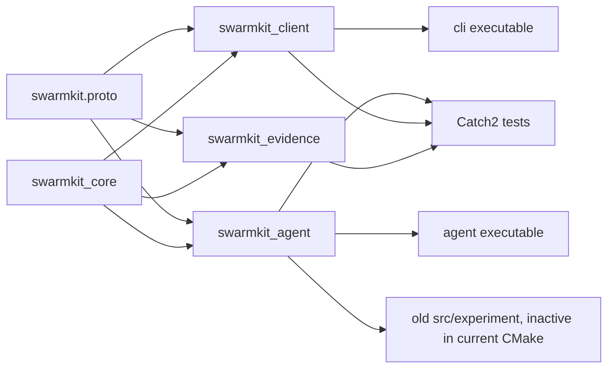
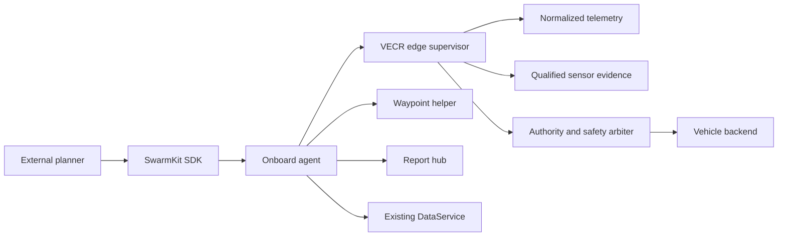

# VECR repository audit — 2026-10-19

Source commit before changes: `1424bd1f5d4347ab4c819f49727c0e9324695406`. The working tree was clean. This audit uses the actual checkout and the supplied VECR prompt/manuscript website. The website is research context; its proposals are not evidence of completed experiments.

## Dependency graph

`src/agent/server.cpp` owns the gRPC services, authority arbiter, telemetry manager, report hub, execution recorder, backend, and active-goal supervisor. `TelemetryManager` alone leases backend telemetry streams; it normalizes and retains frames. `ReportHub` assigns report sequence/session and offers bounded replay. `ActiveGoalSupervisor` issues no camera verification: it monitors a backend goal based on waypoint arrival and sampled deviation. `DataService` already has peer messages and chunked artifacts; it is independent of mission policy. `SimBackend` is a product/backend test tool with a truth frame API, not the retired dissertation simulator.

## Disposition

| Component | Decision | Evidence |
|---|---|---|
| `proto/swarmkit/v1/swarmkit.proto` | REFACTOR | Existing goals/reports have no edge survey or capture evidence type; preserve command, telemetry, data, and authority services. |
| `include/swarmkit/core/telemetry.h` | KEEP | Explicit validity, estimator state, uncertainty semantics and session provenance are required. |
| `src/agent/active_goal_supervisor.*` | KEEP as waypoint helper | A `GOAL_REACHED` result cannot stand for survey completion; avoid merging incompatible facts. |
| `src/agent/telemetry_manager.*` | KEEP | Single normalized telemetry path and bounded history. |
| `src/agent/report_hub.*` | KEEP | One sequenced report stream; extend for edge events. |
| `src/agent/arbiter.cpp`, `command_preconditions.cpp` | KEEP | Safety and authority checks must gate any recovery dispatch. |
| `src/agent/backends/{sim,mavlink}*` | KEEP | The vehicle abstraction and SITL path remain useful. |
| `src/client/*`, `include/swarmkit/client/*` | REFACTOR | Add edge operations using existing gRPC conventions. |
| `src/core/state_acceptance*`, `evidence_store.cpp`, `replay_trace.cpp` and their headers/tests | ARCHIVED AND REMOVED | No current agent/client dependency; superseded pre-release research API is preserved in a verified archive, without compatibility interfaces. |
| `src/experiment/*`, `apps/experiment/*` | ARCHIVED AND REMOVED | Older state-acceptance research harness, inactive in current CMake; not a VECR baseline. |
| `results/dissertation/*`, `docs/dissertation/*` | ARCHIVED AND REMOVED | Previous research line. Its numbers must never be presented as VECR results. |
| `tests/test_backend_contract.cpp`, `test_sim_backend.cpp`, `test_client_integration.cpp`, `test_report_hub.cpp`, `test_arbiter.cpp`, `test_telemetry_manager.cpp` | KEEP | Safety, backend, transport, replay regression coverage. |

## Baseline and debt

- Before enabling tests, `build/mac-release` had `SWARMKIT_BUILD_TESTS=OFF`; `cmake --build ... --target swarmkit_tests` reported unknown target.
- Conan dependencies, including Catch2, are cached. After configuring tests, 156 Catch2 cases were discovered. The first sandboxed run had 38 failures from denied local socket bind/connect (`Operation not permitted`). An approved loopback run passed both CTest entries, including all 156 Catch2 cases.
- The old experimental code was inactive in CMake despite remaining in the tree; old result files occupied about 10 MB.
- `ActiveGoalSupervisor` sets a corridor origin from observed telemetry, which is unsuitable for an immutable graph edge. It has a separate thread per goal and cannot validate capture coverage.
- The current data plane is not yet performance-qualified under concurrent VECR load. Security and transfer quotas remain active; do not infer guaranteed goodput.
- No camera sensor adapter, independent SITL truth feed, or agent-side VECR wire path existed at baseline.

## Intended architecture

The agent may offer a simple waypoint helper and a distinct verified edge operation, but one edge attempt has one authoritative VECR state machine. A planner owns graph/rotor rules. The simulator's private truth is not exposed through sensor or telemetry input to VECR.

The final cleanup and both SHA-256 verified archives are listed in `CLEANUP_INVENTORY.md`.
